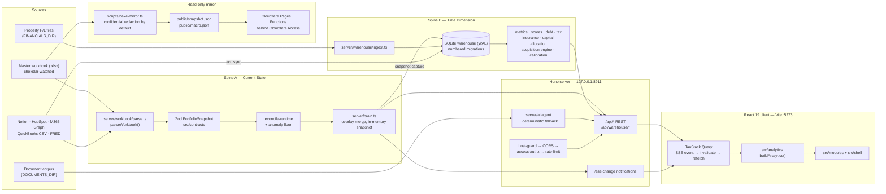

<div align="center">

# Oxford Command Center — "The Brain"

**A local-first investment-intelligence dashboard for a private industrial real-estate portfolio.**
One reconciled, cross-linked view over acquisitions, owned assets, debt, cash, leases, insurance,
taxes, tasks and macro conditions — built on a live Excel workbook and a SQLite financial warehouse.

[](https://github.com/ZeOoba/oxford-command-center/actions/workflows/ci.yml)
[](https://github.com/ZeOoba/oxford-command-center/actions/workflows/order-fragility.yml)


</div>

> [!IMPORTANT]
> This is an internal, single-firm tool. It is not a product, has no multi-tenant auth and no
> public API. The primary surface runs on one workstation (`127.0.0.1`); a read-only static mirror
> runs on Cloudflare Pages behind Cloudflare Access. Firm data never lives in this README.

## Contents

- [What it is](#what-it-is)
- [Architecture](#architecture)
- [Tech stack](#tech-stack)
- [Repository layout](#repository-layout)
- [Getting started](#getting-started)
- [Scripts](#scripts)
- [Quality gates and CI](#quality-gates-and-ci)
- [Data and confidentiality model](#data-and-confidentiality-model)
- [Static mirror deployment](#static-mirror-deployment)
- [Contributing rules](#contributing-rules)
- [Further reading](#further-reading)

## What it is

The Brain reads the firm's master Excel workbook plus a set of optional live sources (Notion,
HubSpot, Microsoft 365 Graph, a QuickBooks CSV export, FRED macro series, a local lease/document
corpus and the Oxford Edge market pipeline) and renders them through a React 19 single-page app.
TypeScript end to end: a Hono server on Node, Zod-validated contracts at every boundary, a
better-sqlite3 warehouse for history, and a streaming tool-using Claude agent behind the Ask panel.

Every live adapter is optional. With a credential unset it returns an empty result plus a
degradation marker rather than throwing, so the app boots against the workbook alone.

## Architecture

The system has **two data spines by design** plus a read-only mirror. The canonical description is
[`architecture/system-overview.md`](architecture/system-overview.md); sequence-level views are in
[`docs/diagrams/`](docs/diagrams/README.md).



| Spine | Flow | Notes |
|---|---|---|
| **A — Current State** | workbook → `parseWorkbook()` → Zod `PortfolioSnapshot` → reconcile → REST + SSE → UI | Notion deals and M365 tasks are loaded inside `parseWorkbook()`; `brain.ts` merges the user overlay and the QuickBooks block. Each refresh also captures occupancy, month, insurance and debt rows into Spine B. |
| **B — Time Dimension** | P&L files → `server/warehouse/ingest.ts` → SQLite → engines → `/api/warehouse/*` | Historical NOI, drivers, benchmarks, health/debt scores, tax, insurance, capital allocation, lease-market positioning and the acquisition-underwriting engine. Also receives Notion/HubSpot acquisition syncs and Oxford Edge pull-queue state. |
| **Mirror** | `bake-mirror.ts` → `public/*.json` → `vite build` → Cloudflare Pages | No Brain Server and no live warehouse at the edge. Pages Functions serve the Ask panel, Access identity and edge acquisition scoring. |

> [!NOTE]
> `Property.noi` (Spine A, a workbook figure) and the warehouse ledger NOI (Spine B) are
> **independent computations**. `npm run reconcile:noi-crosscheck` ties them out per property and
> fails on material drift; no engine may consume both without an explicit basis match.

The client exposes **14 rail destinations in five groups** (Command, Assets, Capital, Market,
System) plus two off-rail routes (System Health, the canonical property page), each a lazily loaded
chunk registered in [`src/shell/modules.tsx`](src/shell/modules.tsx). Routing is
`react-router-dom` (`/:moduleId/*`); the command palette indexes every destination and tab.

## Tech stack

| Layer | Technology |
|---|---|
| Language | TypeScript (strict, `noUncheckedIndexedAccess`), Node >= 20 (CI on Node 24) |
| Client | React 19, Vite 6, TanStack Query + React Virtual, react-router-dom, React Aria Components, Tailwind CSS 4, visx, framer-motion, cmdk, PWA via `vite-plugin-pwa` |
| Server | Hono on `@hono/node-server`, chokidar file watching, Server-Sent Events |
| Data | ExcelJS (workbook + P&L parsing), better-sqlite3 (WAL) warehouse, sqlite-vec + `@huggingface/transformers` local embeddings for document search, pdf-parse / mammoth |
| Contracts | Zod schemas in `src/contracts/` shared by server and client |
| AI | Anthropic SDK; streaming tool-using agent with a deterministic no-key fallback |
| Edge | Cloudflare Pages + Pages Functions, Cloudflare Access (JWT verified at the edge), Wrangler |
| Testing | Vitest (jsdom, forks pool), Testing Library, Playwright + axe-core |
| Tooling | ESLint 9 (`--max-warnings 0`), Prettier, tsx, custom governance and drift checks |

## Repository layout

| Path | Contents |
|---|---|
| [`src/`](src/) | React client: `contracts/` (Zod, the typed boundary), `analytics/` (pure derivations), `data/` (Query hooks, SSE wiring, seed fixtures), `brain/` (command palette, drawers, AI panel), `modules/` (destination and panel folders), `shell/` (app shell and module registry), `primitives/`, `charts/`, `tokens/`, `lib/` |
| [`server/`](server/) | Hono backend: `workbook/` (Excel parser), `warehouse/` (Spine B: ingest, engines, `migrations/`), `ai/`, `sources/` (Notion, M365, QuickBooks, document index), `macro/` (FRED + seeded fallback), `reconcile/`, `brief/` and `briefing/`, `edge/` (Oxford Edge), `notion/` (capital write-back), `ar/`, `alerts/`, `insights/`, `property-financials/`, plus the request-boundary files `host-guard.ts`, `cors-policy.ts`, `access-authz.ts`, `rate-limit.ts` |
| [`functions/`](functions/) | Cloudflare Pages Functions: `api/ai.ts`, `api/whoami.ts`, `api/warehouse/acquisition/score.ts`, shared Access JWT verification in `_shared/` |
| [`scripts/`](scripts/) | Extraction, reconciliation, warehouse backfill/verify/drift/backup, importers, mirror bake and deploy, governance and drift gates, git-hook installers, Windows scheduled-task registration and their PowerShell smoke tests |
| [`architecture/`](architecture/) | Architecture-lock docs plus `ownership.json` / `status.json`, enforced by `scripts/governance-check.ts` |
| [`config/`](config/) | Ratified, versioned rule files (acquisition ruleset, replacement cost, liquidity policy, lease-market) |
| [`tests/`](tests/) | `unit/` (Vitest), `e2e/` (Playwright smoke + axe a11y), `py/`, `fixtures/`, `support/` |
| [`docs/`](docs/) | `adr/`, `constitution/`, `diagrams/`, `ops/` runbooks, `roadmap/`, `scheduled-tasks/`, `superpowers/` specs and plans, design notes |
| [`.claude/`](.claude/) | Agent guardrails: PreToolUse hooks (see [`.claude/hooks/README.md`](.claude/hooks/README.md)) and the `refute-financial-change` workflow |
| [`.github/workflows/`](.github/workflows/) | `ci.yml`, `order-fragility.yml`, `full-gate-selfhosted.yml` |
| `data/` | Local runtime state (warehouse, overlay, alert inbox, document index). Mostly gitignored; see [Data and confidentiality model](#data-and-confidentiality-model) |
| `public/` | Static assets and the Pages SPA fallback; bake output lands here and is gitignored |
| `memory/` | `event_log.md`, an append-only decision and change log |

## Getting started

### Prerequisites

- Node.js 20 or newer (CI uses 24) and npm
- Access to the master workbook (`.xlsx`) for live data; without it the app runs on seed fixtures
- Optional: Playwright Chromium (`npx playwright install chromium`) for end-to-end tests
- Optional: Wrangler + a Cloudflare token for mirror deploys

### Install and run

```bash
npm install            # also installs the git hooks via `prepare`
cp env.example .env    # every key is optional; see below
npm run dev            # Brain Server on :8911 + Vite on :5273
# open http://localhost:5273
```

In a git worktree, start from `worktree-env.example` instead so `WAREHOUSE_DB` points at a
per-worktree SQLite file (one WAL writer at a time) and the server port does not collide.

> [!TIP]
> `dev:server` (tsx watch) can intermittently hang before binding its port on a busy machine.
> `npm run dev:server:once` (no watch) is the reliable fallback; restart it after backend edits.

### Environment variables

`env.example` is tracked and holds **names only, never values**; `.env` is gitignored. Every key
either has a working default or disables one feature when unset.

<details>
<summary>Variable names by area</summary>

| Area | Variables |
|---|---|
| Workbook and paths | `WORKBOOK_PATH`, `WORKBOOK_AS_OF`, `REPORT_DATE`, `SNAPSHOT_PATH`, `OVERLAY_PATH`, `ALLOW_EMPTY_OVERLAY`, `FINANCIALS_DIR`, `QUICKBOOKS_CSV`, `OXFORD_EDGE_DIR`, `ORA_PYTHON` |
| Warehouse | `WAREHOUSE_DB`, `WAREHOUSE_BUSY_TIMEOUT_MS` |
| Server and request boundary | `BRAIN_SERVER_PORT`, `BRAIN_ALLOWED_HOSTS`, `BRAIN_HOST_AUTH`, `ACCESS_REQUIRE`, `ACCESS_AUD`, `ACCESS_ISSUER`, `ACCESS_ALLOWLIST`, `ORA_SERVER` |
| Notion | `NOTION_TOKEN`, `NOTION_VERSION`, `NOTION_DEALS_DB`, `NOTION_DEALS_DATA_SOURCE`, `NOTION_DEALS_ID_PROP`, `NOTION_DEALS_NAME_ALIASES`, `NOTION_TENANT_DB`, `NOTION_TENANT_DATA_SOURCE`, `NOTION_CONFIDENTIAL_NAME_PATTERNS` |
| HubSpot / Microsoft 365 | `HUBSPOT_TOKEN`, `GRAPH_TENANT_ID`, `GRAPH_CLIENT_ID`, `GRAPH_CLIENT_SECRET`, `GRAPH_TOKEN`, `GRAPH_USER` |
| AI | `ANTHROPIC_API_KEY`, `ANTHROPIC_MODEL`, `ANTHROPIC_EFFORT`, `OM_EXTRACT_MODEL` |
| Macro | `FRED_API_KEY` |
| Documents (RAG) | `DOCUMENTS_DIR`, `DOC_INDEX_PATH`, `DOCUMENTS_INCLUDE_DIRS`, `DOCUMENTS_PATH_INCLUDE`, `DOCUMENTS_EXCLUDE`, `DOCUMENTS_ALLOW_UNSCOPED`, `DOCUMENTS_MAX_DEPTH`, `DOCUMENTS_MAX_FILES`, `DOCUMENTS_MAX_FILE_MB`, `DOCUMENTS_MAX_CHUNKS_PER_DOC`, `DOCUMENTS_EMBED_BATCH`, `DOCUMENTS_EMBED_LIMIT`, `DOCUMENTS_DROP_NONLEASE`, `DOCUMENTS_NONLEASE_PATTERNS` |
| Alerts and brief | `ALERT_INBOX_PATH`, `ALERT_STATE_PATH`, `ALERT_CONFIRM_CLEAR_RUNS`, `BRIEF_ENABLED`, `BRIEF_HEALTH_PATH`, `BRIEF_OUTBOX_DIR`, `BRIEF_SEND_SCRIPT`, `BRIEF_DASHBOARD_URL` |
| AR | `AR_INBOX`, `AR_MAPPING_CACHE` |
| Mirror and confidentiality | `MIRROR_INCLUDE_CONFIDENTIAL`, `BRAIN_BAKE_SOURCE_URL`, `CONFIDENTIAL_TERMS_PATH`, `CONFIDENTIAL_TERMS_ALLOW_PLACEHOLDER` |
| Gates | `REFUTE_BASE` |

</details>

## Scripts

All commands are `npm run <script>`; [`package.json`](package.json) is the source of truth.

| Script | Purpose |
|---|---|
| `dev` | `dev:server` + `dev:web` concurrently |
| `dev:web` / `dev:server` / `dev:server:once` | Vite only / backend under `tsx watch` with a watchdog / backend without watch |
| `build` | `tsc --noEmit` then `vite build` (a `prebuild` step regenerates the confidential-scan types) |
| `preview` | Serve the production build |
| `gate` | Full local gate (see [Quality gates and CI](#quality-gates-and-ci)) |
| `gate:ci` | CI-safe subset of `gate`, plus `build` and `check:bundle` |

<details>
<summary>Quality and checks</summary>

| Script | Purpose |
|---|---|
| `typecheck` | Three `tsc --noEmit` passes: app, `tsconfig.node.json`, `functions/tsconfig.json` |
| `lint` / `format` | ESLint with zero warnings / Prettier write |
| `test` / `test:watch` / `test:coverage` | Vitest single run / watch / with V8 coverage |
| `test:shuffle` | Vitest with shuffled file and test order (fragility canary) |
| `test:e2e` | Playwright smoke + axe accessibility specs |
| `governance` | Validates `CLAUDE.md`, architecture docs, `ownership.json`, `status.json`, duplicate route prefixes |
| `check:dev-css` | Runs the dev-mode CSS pipeline to catch parse errors production minification masks |
| `check:css-tokens` | Every `var(--name)` under `src/` must be defined under `src/` |
| `check:schema-drift` | Cross-checks migration columns, Zod write schemas and bound INSERT/UPDATE arguments |
| `check:bundle` | Bundle budget: entry < 250 kB gzip, lazy chunks < 60 kB gzip |
| `check:refute` | Financial-decision commits must carry a `Refute-Reviewed:` / `Refute-Skip:` trailer (`--strict` in CI) |
| `generate:confidential-scan-types` | Generates the gitignored `.d.mts` for the pre-push confidentiality scan |
| `hooks:install` | Installs the `pre-push` and `commit-msg` git hooks (also run by `prepare`) |

</details>

<details>
<summary>Reconciliation</summary>

| Script | Purpose |
|---|---|
| `reconcile` | Re-reads the workbook's own totals and asserts derived aggregates match to the dollar (local only) |
| `reconcile:snapshot` | Same checks against the committed snapshot, no workbook I/O (runs in CI) |
| `reconcile:leases` | Cross-checks lease data against Notion |
| `reconcile:noi-crosscheck` | Spine A vs Spine B NOI tie-out per property (local only) |

</details>

<details>
<summary>Warehouse, imports and calibration</summary>

| Script | Purpose |
|---|---|
| `extract` | Parse the workbook to the snapshot JSON |
| `warehouse:backfill` | Populate the SQLite warehouse from the P&L files |
| `warehouse:verify` | Fresh SQLite in a temp dir, full ingest, assertions (never touches the live DB) |
| `warehouse:drift` | Compare the live warehouse against a fresh re-ingest |
| `warehouse:import-loss-runs` | Import insurance loss-run / policy data (replaces placeholder fixtures, see [`docs/placeholder-data.md`](docs/placeholder-data.md)) |
| `warehouse:import-pca` | Import the property-condition (PCA) register |
| `lease-market:ingest` / `lease-market:compute` | Ingest lease-market feed data / compute positioning |
| `calibration:propose` / `calibration:promote` | Propose and promote calibration parameter changes |
| `xref:seed` | Report unlinked lease-market entities; `-- --write` mirrors config-blessed links |
| `backup` / `backup:verify` | Encrypted warehouse backup / restore verification |
| `index:docs` | Build the local document-search index from `DOCUMENTS_DIR` |

</details>

<details>
<summary>Mirror and worktrees</summary>

| Script | Purpose |
|---|---|
| `bake` | Bake `public/snapshot.json` + `public/macro.json` (redacted by default) |
| `build:mirror` | `bake` then `build` |
| `deploy:mirror` | Manual, un-hardened `wrangler pages deploy`; the scheduled deploy uses `scripts/deploy-mirror.ps1` instead |
| `worktree -- <add\|remove\|prune>` | Junction-safe worktree management (`scripts/safe-worktree.ts`) |

</details>

## Quality gates and CI

**Every commit must leave `npm run gate` green.** Never bypass with `--no-verify`.

| Step | `gate` (local) | `gate:ci` |
|---|:---:|:---:|
| `governance` | yes | yes |
| `typecheck` | yes | yes |
| `lint` | yes | yes |
| `check:dev-css` | yes | yes |
| `check:css-tokens` | yes | yes |
| `check:schema-drift` | yes | yes |
| `test` | yes | yes |
| `reconcile:snapshot` | yes | yes |
| `reconcile` | yes | — |
| `reconcile:noi-crosscheck` | yes | — |
| `warehouse:verify` | yes | — |
| `warehouse:drift` | yes | — |
| `build` | — | yes |
| `check:bundle` | — | yes |

The four local-only steps need the workbook and the P&L corpus, which never leave firm machines.
`tests/unit/gate-scripts.test.ts` fails if `gate:ci` stops being exactly `gate` minus those four
steps plus `build` and `check:bundle`.

### Refute requirement for financial-decision code

A change to financial-decision source (engine math, scoring, NOI, collections conditions, the
financial overlay, acquisition contracts and similar) must carry its **own** commit trailer:

```text
Refute-Reviewed: wf_<run id>     # the refute-financial-change adversarial workflow ran on it
Refute-Skip: <justification>     # rare, justified exemption
```

`server/` and `scripts/` are **default-deny**: every path there is financial-decision source unless
explicitly allow-listed in `scripts/check-refute-required.ts`. Attestation is per commit, not per
range, and merge commits are inspected too. Squash merges must carry the union of the branch's
trailers. Doctrine: [`architecture/coding-standards.md`](architecture/coding-standards.md).

### Workflows

| Workflow | Trigger | What it runs |
|---|---|---|
| [`ci.yml`](.github/workflows/ci.yml) | push to `main`, every PR | Job `gate`: `npm run gate:ci`. Job `refute-required` (PRs): `check:refute --strict` against the PR head. Runs on `ubuntu-latest`, or a self-hosted Windows runner when the repo variable `CI_RUNNER=self`. Read-only token permissions. |
| [`order-fragility.yml`](.github/workflows/order-fragility.yml) | Mondays 09:00 UTC + manual | `npm run test:shuffle` canary (non-blocking) |
| [`full-gate-selfhosted.yml`](.github/workflows/full-gate-selfhosted.yml) | manual only | Full `npm run gate` on a self-hosted runner holding the data corpus (no runner currently registered for its label set) |

### Git hooks

Installed by `npm install` (`prepare`) or `npm run hooks:install`:

- **pre-push** — confidentiality scan of every pushed ref (fail-closed), a refute-trailer check, and
  an advisory, never-blocking NOI cross-check.
- **commit-msg** — rejects malformed AI `Co-Authored-By:` trailers against an explicit allowlist.

## Data and confidentiality model

- **Source of record** is the master workbook; the warehouse is rebuilt from the P&L files with
  `warehouse:backfill`. Neither is ever committed.
- **Gitignored:** `.env`, the SQLite warehouse (`data/warehouse/`), `data/overlay.json` (the single
  user write surface), alert state and inbox, the document index, backups, AR working
  directories, raw lease-market exports, the brief outbox, and all bake output
  (`public/snapshot.json`, `public/macro.json`, `public/warehouse.json`).
- **Tracked data** is limited to files CI or the app read directly, such as the snapshot that
  `reconcile:snapshot` validates and the AR mapping cache; see [`.gitignore`](.gitignore) for the
  exact rules.
- **Confidential deals** carry `confidential: true`. The mirror bake **redacts them by default**:
  deal records, orphaned counterparties, tasks naming them, and any field matching the
  confidential roster are dropped, and the bake refuses outright if the roster is unreadable.
  Including them requires an explicit `MIRROR_INCLUDE_CONFIDENTIAL=1`, used only for a target
  verified to sit behind Cloudflare Access.
- **The bake refuses** to publish a degraded deals source or an internally inconsistent snapshot.
- **Request boundary:** host allowlist (DNS-rebinding defense), localhost-only CORS, optional
  Cloudflare Access JWT verification (`ACCESS_REQUIRE=1`), and per-route rate and concurrency
  limits on AI, OM extraction and document search.
- **AI egress:** the agent runs a confidential-roster scan over questions, history and tool
  results; on the mirror, the Ask endpoint refuses model calls when no scan is available.

## Static mirror deployment

The mirror is a read-only copy for remote use: no Brain Server, no live warehouse.

1. `scripts/deploy-mirror.ps1`, registered as a Windows scheduled task by
   `scripts/register-mirror-task.ps1`, runs hourly and at 06:45 ET.
2. It syncs an **isolated build root** hard-reset to `origin/main`, so the deploy never depends on
   the state of a working checkout.
3. It bakes (`bake-mirror.ts`, optional `bake-warehouse.ts`), builds, and deploys with the pinned
   local Wrangler under a bounded timeout.
4. It then **re-proves the Access gate**: the root, every baked top-level JSON file and every Pages
   Function route, on both the production URL and the per-deployment `*.pages.dev` alias, must
   redirect unauthenticated requests to Cloudflare Access. Any other answer fails the run and
   raises an alert.

`npm run deploy:mirror` exists for a human at a terminal and has none of that hardening.

> [!WARNING]
> A Cloudflare Access application on the apex domain does not automatically cover per-deployment
> `<hash>.pages.dev` URLs. Both must be listed as Access destinations.

## Contributing rules

Read [`CLAUDE.md`](CLAUDE.md) in full before editing. The essentials:

- **Work in an isolated worktree** (`npm run worktree -- add ...`), with its own `.env` from
  `worktree-env.example`. Claim it in `architecture/status.json`.
- **Stage explicit paths only.** Never `git add -A` or `git add .`; treat every uncommitted file
  you did not create as another writer's work.
- **Architect-owned files** (`CLAUDE.md`, `architecture/`, `package.json`, `tsconfig.json`,
  `vite.config.ts`, `server/index.ts`, `src/contracts/`, `src/analytics/engine.ts`, the warehouse
  `db.ts` / `migrate.ts` / `migrations/`, `scripts/governance-check.ts`) need `review_needed: true`
  in `status.json` and acknowledgment before editing. Ownership map:
  [`architecture/agent-assignments.md`](architecture/agent-assignments.md).
- **Migrations are architect-owned and append-only.** Add a new numbered `.sql` file; never edit
  an applied one, never reuse a number (one historical `017` duplicate is documented in
  [`architecture/database-schema.md`](architecture/database-schema.md)).
- **`config/*.json` files are ratified.** Changes need a version bump and re-ratification, never a
  silent edit. Governor constants are never changed without explicit approval.
- **Financial-decision changes** need a `Refute-Reviewed:` trailer from the refute workflow.
- **PRs** use `type(scope): description`, must have a green gate, and are squash-merged. Never
  force-push `main`.

## Further reading

| Document | Topic |
|---|---|
| [`architecture/system-overview.md`](architecture/system-overview.md) | Spines, server, client, module map, static mirror |
| [`architecture/api-contracts.md`](architecture/api-contracts.md) | REST and SSE contracts |
| [`architecture/database-schema.md`](architecture/database-schema.md) | Warehouse schema and migration history |
| [`architecture/coding-standards.md`](architecture/coding-standards.md) | Coding standards and refute doctrine |
| [`architecture/system-of-record.md`](architecture/system-of-record.md) | Which source owns which fact |
| [`architecture/agent-assignments.md`](architecture/agent-assignments.md) | Roles and file ownership |
| [`docs/adr/`](docs/adr/README.md) | Architecture decision records |
| [`docs/constitution/ENGINEERING_CONSTITUTION.md`](docs/constitution/ENGINEERING_CONSTITUTION.md) | Engineering constitution |
| [`docs/diagrams/`](docs/diagrams/README.md) | Sequence-level diagrams |
| [`.claude/hooks/README.md`](.claude/hooks/README.md) | Agent guardrail hooks |
| [`CHANGES.md`](CHANGES.md) / [`CHANGELOG.md`](CHANGELOG.md) | Change history |
