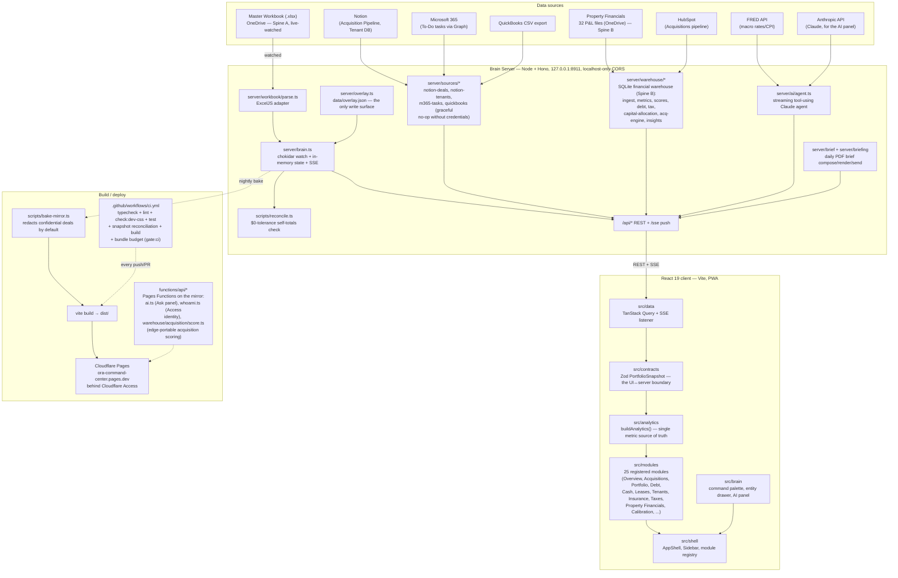

# Oxford Command Center — "The Brain"

## 1. Overview

The Oxford Command Center is Gabriel Goldberg's internal, local-first investment-intelligence
dashboard for Oxford Realty Advisors (ORA) — a single React application that reads the firm's live
master Excel workbook plus a growing set of supplemental live sources (Notion, HubSpot, Microsoft
365, QuickBooks CSV exports, FRED macro data) and renders one reconciled, cross-linked view over
the acquisitions pipeline, owned portfolio, debt, cash, leases, tenants, insurance, taxes, tasks,
and macro conditions. It is built and used by one principal (Gabriel), for one firm, and is never
deployed publicly — the primary surface runs on Gabriel's own machine, with a read-only static
mirror on Cloudflare Pages behind Cloudflare Access for phone/away use. TypeScript end to end
(React 19 client, Node/Hono server, Zod-validated contracts throughout).

## 2. Architecture / data flow



**Two data spines, by design** (documented in `architecture/system-overview.md`):

- **Spine A — "Current State"**: the live workbook, parsed → Zod-validated → reconciled →
  pushed to the client via REST + SSE. Supplemented by live Notion/HubSpot/M365/QuickBooks/FRED
  adapters, each of which degrades gracefully (empty result, not a crash) when its credential is
  unconfigured.
- **Spine B — "Time Dimension"**: a SQLite financial warehouse (`server/warehouse/`) built by
  ingesting 32 property P&L files, used for historical NOI trend, drivers, benchmarks, health
  scores, debt scoring, tax analysis, capital allocation, and the acquisition-underwriting engine.
  `Property.noi` (Spine A) and the warehouse ledger NOI (Spine B) are independent computations.
  A local-only gate (`npm run reconcile:noi-crosscheck`, wired into `npm run gate` — not
  `gate:ci`, since CI has no live workbook or warehouse DB) cross-checks them per property and
  fails on material drift; in-band drift and structurally-expected mismatches (e.g. a
  newly-acquired property pre-ingest) warn without failing.

## 3. Directory structure

| Path | What's actually there |
|---|---|
| `src/` | The React 19 client — `contracts/` (Zod schemas, the sole typed boundary), `analytics/` (pure derivations, unit-tested), `data/` (TanStack Query hooks, SSE wiring, seed fixtures), `brain/` (command palette, entity drawer, AI panel, workspaces), `modules/` (25 folders, one per dashboard module), `shell/` (app shell, sidebar, module registry), `primitives/` and `charts/` (design-system components, visx charts), `tokens/` (theme tokens). |
| `server/` | The Node/Hono backend — `workbook/` (live Excel parser + counterparty graph), `warehouse/` (the SQLite Spine-B pipeline: ingest, metrics, scores, debt, tax, capital-allocation, acquisition engine, insights), `ai/` (streaming Claude agent + deterministic fallback + comps), `sources/` (Notion, HubSpot via warehouse, M365 Graph, QuickBooks CSV adapters), `alerts/`, `brief/` + `briefing/` (daily PDF brief pipeline), `macro/` (FRED adapter + seeded fallback), `reconcile/`, `overlay.ts` (the one write surface). |
| `scripts/` | One-off and CI-invoked TypeScript/PowerShell scripts: workbook extraction, reconciliation, warehouse backfill/verify/drift, mirror baking, governance and refute-required gates, Windows scheduled-task registration for the always-on Brain Server and the mirror deploy. |
| `functions/` | Cloudflare Pages Functions — `api/ai.ts` serves the Ask panel on the static mirror (no Brain Server there). |
| `architecture/` | Living architecture-lock docs: `system-overview.md`, `api-contracts.md`, `database-schema.md`, `coding-standards.md`, plus `ownership.json`/`status.json` consumed by `governance-check.ts`. |
| `config/` | Ratified, versioned rule files (e.g. the acquisition scorecard ruleset) — changes require a version bump and re-ratification, never a silent edit. |
| `data/` | Local runtime state: workbook snapshots, the SQLite warehouse, the alert inbox, `overlay.json` (user write surface), a document search index. Gitignored except for structure. |
| `tests/` | `unit/` (210+ Vitest spec files), `e2e/` (Playwright + axe accessibility specs), `fixtures/`. |
| `docs/` | Design-handoff and parity-audit notes, scheduled-task docs, capital-model notes, a `superpowers/` subfolder of specs and plans. |
| `public/` | Static assets plus the baked `snapshot.json`/`macro.json` fallback used by the mirror. |
| `design_handoff_ora_command_center/` | The original design-handoff prompt set and reference screens used to scaffold the UI. |
| `memory/` | `event_log.md` — an append-only project decision/change log. |

## 4. Setup & run

```bash
npm install
npm run dev          # Brain Server (:8911) + web app (:5273) together, hot reload on both
# open http://localhost:5273
```

The workbook path defaults to
`~/OneDrive - Oxford Capital Partners/eric spreadsheets/Master Excel Template Company Wide -- Oxford.xlsx`
(`server/config.ts`) — override with the `WORKBOOK_PATH` env var.

Scripts, pulled directly from `package.json`:

| Command | Purpose |
|---|---|
| `npm run dev` | `dev:server` + `dev:web` concurrently |
| `npm run dev:web` | Vite dev server only |
| `npm run dev:server` | Backend with `tsx watch` (can intermittently hang on this machine before binding its port — see Notes & Gotchas) |
| `npm run dev:server:once` | Backend via plain `tsx`, no watch — the reliable fallback |
| `npm run build` | `tsc --noEmit` then `vite build` to `dist/` |
| `npm run preview` | Preview the production build |
| `npm run typecheck` | Three separate `tsc --noEmit` passes: app, `tsconfig.node.json`, `functions/tsconfig.json` |
| `npm run lint` | `eslint . --max-warnings 0` |
| `npm run format` | `prettier --write .` |
| `npm run test` | Vitest (single run) |
| `npm run test:coverage` | Vitest with coverage |
| `npm run test:watch` | Vitest watch mode |
| `npm run test:shuffle` | Vitest with shuffled file/test order (fragility check) |
| `npm run test:e2e` | Playwright (`npx playwright install chromium` first) |
| `npm run extract` | Parse the workbook → `data/snapshots/portfolio.json` |
| `npm run reconcile` | Re-read the workbook's own totals, assert derived aggregates match to the dollar |
| `npm run reconcile:leases` | Cross-check lease data against Notion |
| `npm run warehouse:backfill` / `:verify` / `:drift` | Populate / validate / drift-check the SQLite warehouse |
| `npm run build:mirror` | Bake `public/{snapshot,macro}.json`, then `vite build` — the static mirror artifact |
| `npm run deploy:mirror` | `build:mirror` then `wrangler pages deploy` |
| `npm run governance` | Validates CLAUDE.md + architecture docs + `ownership.json`/`status.json` |
| `npm run check:bundle` | Enforces the bundle-size budget (entry < 250 kB gzip, lazy chunks < 60 kB gzip) |
| `npm run check:refute` | Checks that financial-decision code changes carry a Refute-Reviewed commit trailer |
| `npm run gate` | Full local gate: governance → typecheck → lint → check:dev-css → test → reconcile → warehouse:verify → warehouse:drift |
| `npm run gate:ci` | The CI-safe subset (no workbook access): typecheck → lint → check:dev-css → test → build → check:bundle |

CI (`.github/workflows/ci.yml`) runs `npm run gate:ci` on every push/PR, plus a separate
`refute-required` job on PRs that enforces the Refute-Reviewed trailer for financial-decision
diffs.

## 5. Key components/modules

- **`server/workbook/parse.ts`** — the live Excel adapter: detects data rows dynamically, quarantines bad values into `dataQuality` flags instead of rendering them, links entities, and returns a Zod-validated snapshot. Shared by the dev server, `extract`, and `reconcile`.
- **`server/brain.ts`** — watches the workbook file (chokidar), holds the in-memory snapshot, and broadcasts changes over SSE.
- **`server/overlay.ts`** / `data/overlay.json` — the single user-write surface; gitignored, never committed.
- **`server/warehouse/`** — the SQLite (better-sqlite3) financial warehouse: ingest pipeline, NOI trend/drivers, benchmarks, health/attention/capital scores, debt scoring, tax analysis, capital-allocation modeling, and the acquisition-underwriting engine (with Notion + HubSpot sync).
- **`server/ai/agent.ts`** — the streaming, tool-using Claude agent behind the Ask panel (model defaults to `claude-opus-5`); `server/ai/respond.ts` is the deterministic no-key fallback.
- **`server/macro/fred.ts` / `getMacro.ts`** — live FRED adapter (DGS10, DGS2, SOFR, FEDFUNDS, CPIAUCSL) with a seeded fallback when `FRED_API_KEY` is unset.
- **`server/sources/`** — live adapters for Notion (Acquisition Pipeline, Tenant DB), Microsoft 365 To-Do (Graph), and QuickBooks CSV; each returns gracefully (empty/unchanged) with no credential configured, never throwing.
- **`server/brief/` + `server/briefing/`** — composes, renders, and sends the daily PDF brief.
- **`src/contracts/index.ts`** — `PortfolioSnapshot`, the one Zod-validated shape everything in the UI renders from; validated on both server parse and client fetch.
- **`src/analytics/engine.ts`** — `buildAnalytics()`, the single source of truth for derived metrics, and the rules-based insight generator (balloon ≤18mo, tenant concentration >25/50%, leases ≤90 days, lapsed insurance, low occupancy).
- **`src/shell/modules.tsx`** — the module registry; 25 entries grouped into Command / Assets / Capital / Market, each a lazily-loaded chunk.
- **`src/brain/`** — the ⌘K command palette, entity drawer (drill-through), AI panel, and named workspaces (persisted to `localStorage`).
- **`src/data/seed-deals.ts` / `seed-counterparties.ts`** — local-dev seed data standing in for the live HubSpot/Notion pipeline shape. **Contains real portfolio figures — never used in demos or public surfaces**, and one seeded deal is confidentiality-flagged and excluded from the mirror bake by default.
- **`scripts/bake-mirror.ts`** — bakes the static snapshot for the Cloudflare Pages mirror, redacting confidential deals unless `MIRROR_INCLUDE_CONFIDENTIAL=1` is explicitly set for an Access-verified target.
- **`architecture/`** — the architecture-lock docs (`system-overview.md`, `api-contracts.md`, `database-schema.md`, `coding-standards.md`) that `governance-check.ts` enforces changes against.

## 6. Notes & Gotchas

- **`dev:server` (tsx watch) can hang before binding its port** (~2/5 trials observed on this
  machine) — root cause undetermined (likely transient resource contention from many concurrent
  Node processes). `dev:server:once` (no watch, 5/5 reliable) is the safer manual fallback and is
  what the Windows scheduled-task launcher uses; it just means no hot reload, so restart manually
  after backend edits.
- **The workbook path resolves lazily, at call time, not at module load.** A top-level `const`
  would freeze whatever `process.env` held before `.env` is loaded, silently discarding any
  `WORKBOOK_PATH` override — confirmed the hard way on 2026-07-08.
- **`reconcile`, `warehouse:verify`, and `warehouse:drift` are local-only** — they need the
  canonical OneDrive workbook, which GitHub-hosted runners don't have. `gate:ci` deliberately
  omits them; only the full local `gate` runs them.
- **Two independent NOI numbers exist and are not reconciled**: `Property.noi` (Spine A, a
  workbook formula cell) and the warehouse ledger NOI (Spine B, `Σ revenue + recovery − opex`).
  No capital-allocation or scoring engine may consume both without an explicit tie-out.
- **The mirror redacts confidential deals by default.** Including one requires an explicit
  `MIRROR_INCLUDE_CONFIDENTIAL=1` opt-in, and only ever against a target already verified to be
  behind Cloudflare Access (a 302 to the Access login, not a 200).
- **Preview/hash deploy URLs bypass the Access app unless added explicitly** — an Access
  application on the apex domain does not cover per-deployment `<hash>.pages.dev` URLs; both the
  apex and the `*.pages.dev` wildcard must be listed as destinations.
- **`brain.oxfordra.net` does not currently route anywhere usable** — its DNS lives on NS1/Netlify,
  not Cloudflare, so a tunnel CNAME to it resolves only to a non-routable address. The working
  remote-access path today is the Cloudflare Pages mirror itself, not that subdomain.
