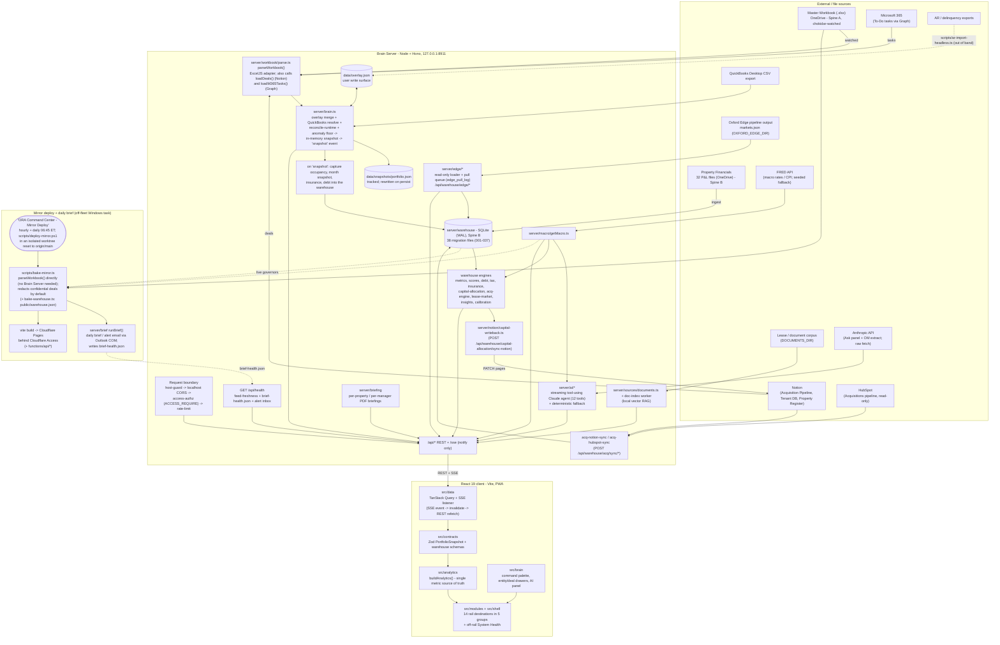

# Oxford Command Center — "The Brain"

## 1. Overview

The Oxford Command Center is Gabriel Goldberg's internal, local-first investment-intelligence
dashboard for Oxford Realty Advisors (ORA) — a single React application that reads the firm's live
master Excel workbook plus a growing set of supplemental live sources (Notion, HubSpot, Microsoft
365, QuickBooks CSV exports, FRED macro data) and renders one reconciled, cross-linked view over
the acquisitions pipeline, owned portfolio, debt, cash, leases, tenants, insurance, taxes, tasks,
and macro conditions. It is built and used by one principal (Gabriel), for one firm, and is never
deployed publicly — the primary surface runs on Gabriel's own machine, with a read-only static
mirror on Cloudflare Pages behind Cloudflare Access for phone/away use. TypeScript end to end
(React 19 client, Node/Hono server, Zod-validated contracts throughout).

## 2. Architecture / data flow


<!-- diagram-verified: 2026-10-06 (against origin/main 0d98bfc). Sequence-level views: docs/diagrams/README.md -->

**Two data spines, by design** (documented in `architecture/system-overview.md`):

- **Spine A — "Current State"**: the live workbook, parsed → Zod-validated → reconciled →
  pushed to the client via REST + SSE. Notion deals and M365 tasks are fetched inside
  `parseWorkbook()`; `brain.ts` merges the overlay and the QuickBooks CSV block. Each live adapter
  degrades gracefully (empty result plus a degradation marker, not a crash) when its credential is
  unconfigured. Every non-action refresh also captures occupancy, month, insurance and debt rows
  into Spine B.
- **Spine B — "Time Dimension"**: a SQLite financial warehouse (`server/warehouse/`) built by
  ingesting 32 property P&L files, used for historical NOI trend, drivers, benchmarks, health
  scores, debt scoring, tax analysis, capital allocation, and the acquisition-underwriting engine.
  It also receives explicit Notion / HubSpot acquisition syncs, FRED macro inputs, and Oxford Edge
  pull-queue state, and writes capital-allocation results back to Notion on request.
  `Property.noi` (Spine A) and the warehouse ledger NOI (Spine B) are independent computations.
  A local-only gate (`npm run reconcile:noi-crosscheck`, wired into `npm run gate` — not
  `gate:ci`, since CI has no live workbook or warehouse DB) cross-checks them per property and
  fails on material drift; in-band drift and structurally-expected mismatches (e.g. a
  newly-acquired property pre-ingest) warn without failing.

## 3. Directory structure

| Path | What's actually there |
|---|---|
| `src/` | The React 19 client — `contracts/` (Zod schemas, the sole typed boundary), `analytics/` (pure derivations, unit-tested), `data/` (TanStack Query hooks, SSE wiring, seed fixtures), `brain/` (command palette, entity drawer, AI panel, workspaces), `modules/` (30 folders: 14 rail destinations plus the per-tab panels they compose), `shell/` (app shell, sidebar, module registry), `primitives/` and `charts/` (design-system components, visx charts), `tokens/` (theme tokens), `lib/` (shared client helpers). |
| `server/` | The Node/Hono backend — `workbook/` (live Excel parser + counterparty graph), `warehouse/` (the SQLite Spine-B pipeline: ingest, metrics, scores, debt, tax, insurance, capital-allocation, acquisition engine, lease-market, calibration; 38 SQL migration files in `warehouse/migrations/`, numbered 001-037 with two files sharing `017`), `ai/` (streaming Claude agent + deterministic fallback + comps), `sources/` (Notion, M365 Graph, QuickBooks CSV adapters and the local document-RAG index; HubSpot is pulled by `warehouse/acq-hubspot-sync.ts`), `ar/` (receivables/delinquency import), `alerts/`, `brief/` (daily brief + alert email) and `briefing/` (per-property / per-manager PDF briefings), `macro/` (FRED adapter + seeded fallback), `reconcile/`, `insights/`, `notion/` (capital write-back), `edge/` (Oxford Edge market loader + pull queue, mounted at `/api/warehouse/edge`), `lib/` (shared server helpers), `overlay.ts` (the one write surface), `reconcile-runtime.ts` (the in-process snapshot check `brain.ts` runs on every refresh), `feed-freshness.ts` (per-feed staleness for `/api/health`), `anomaly-floor.ts`, `startup.ts`, plus the request-boundary files `host-guard.ts`, `cors-policy.ts`, `access-authz.ts`, `rate-limit.ts`. |
| `scripts/` | One-off and CI-invoked TypeScript/PowerShell scripts: workbook extraction, reconciliation (`reconcile*.ts`), warehouse backfill/verify/drift/backup, mirror and warehouse baking, governance / write-schema-drift / bundle / refute-required gates, git-hook installers (pre-push confidentiality scan, commit-msg trailer guard), and Windows scheduled-task registration for the always-on Brain Server and the mirror deploy (plus an off-fleet mirror classifier). |
| `functions/` | Cloudflare Pages Functions — `api/ai.ts` (Ask panel on the static mirror, no Brain Server there), `api/whoami.ts` (Cloudflare Access identity), `api/warehouse/acquisition/score.ts` (edge acquisition scoring). |
| `architecture/` | Living architecture-lock docs: `system-overview.md`, `api-contracts.md`, `database-schema.md`, `coding-standards.md`, plus `ownership.json`/`status.json` consumed by `governance-check.ts`. |
| `config/` | Ratified, versioned rule files (acquisition scorecard ruleset, replacement-cost table, lease-market config) — changes require a version bump and re-ratification, never a silent edit. |
| `data/` | Local runtime state: workbook snapshots (`snapshots/portfolio.json` is the one tracked snapshot), the SQLite warehouse, the alert inbox, `overlay.json` (user write surface), a document search index. Gitignored except for the tracked snapshot and the AR mapping cache. |
| `tests/` | `unit/` (430+ Vitest test files), `e2e/` (Playwright `smoke` + axe `a11y` specs), `fixtures/`. |
| `docs/` | `adr/` (architecture decision records), `constitution/` (engineering constitution), `ops/` (runbooks and audits), `capital/`, `roadmap/`, `scheduled-tasks/`, `templates/`, a `superpowers/` subfolder of specs and plans, and design-parity notes. |
| `public/` | Static assets and the Pages `_redirects` SPA fallback; the baked `snapshot.json` / `macro.json` (and optional `warehouse.json`) are generated here by the bake scripts. |
| `design_handoff_ora_command_center/` | The original design-handoff prompt set and reference screens used to scaffold the UI. |
| `memory/` | `event_log.md` — an append-only project decision/change log. |
| `.claude/` | Project guardrails: `settings.json`, PreToolUse hooks (`bash-guard.mjs`, `file-guard.mjs`, `session-start.sh`; see `.claude/hooks/README.md`) and the `refute-financial-change` workflow. |
| `.github/workflows/` | `ci.yml`, `order-fragility.yml`, `full-gate-selfhosted.yml` (see section 4). |

## 4. Setup & run

```bash
npm install
npm run dev          # Brain Server (:8911) + web app (:5273) together, hot reload on both
# open http://localhost:5273
```

The workbook path defaults to
`~/OneDrive - Oxford Capital Partners/eric spreadsheets/Master Excel Template Company Wide -- Oxford.xlsx`
(`server/config.ts`) — override with the `WORKBOOK_PATH` env var.

Environment: copy `env.example` to `.env` (`cp env.example .env`; `.env` is gitignored, and
`env.example` is tracked, so it holds keys only, never values). Every key is optional and
either has a working default or disables one feature when unset (Notion, HubSpot, Graph,
Anthropic, FRED, Oxford Edge, warehouse path and so on). In a git worktree use
`worktree-env.example` instead so `WAREHOUSE_DB` points at a per-worktree SQLite file (one WAL
writer at a time) and the server port does not collide.

Scripts, pulled directly from `package.json`:

| Command | Purpose |
|---|---|
| `npm run dev` | `dev:server` + `dev:web` concurrently |
| `npm run dev:web` | Vite dev server only |
| `npm run dev:server` | Backend with `tsx watch` behind `scripts/dev-watchdog.cjs` (can intermittently hang on this machine before binding its port — see Notes & Gotchas) |
| `npm run dev:server:once` | Backend via plain `tsx`, no watch — the reliable fallback |
| `npm run build` | `tsc --noEmit` then `vite build` to `dist/` (a `prebuild` step regenerates the confidential-scan types) |
| `npm run preview` | Preview the production build |
| `npm run typecheck` | Three separate `tsc --noEmit` passes: app, `tsconfig.node.json`, `functions/tsconfig.json` (preceded by regenerating the confidential-scan types) |
| `npm run lint` | `eslint . --max-warnings 0` |
| `npm run format` | `prettier --write .` |
| `npm run test` | Vitest (single run) |
| `npm run test:coverage` | Vitest with coverage |
| `npm run test:watch` | Vitest watch mode |
| `npm run test:shuffle` | Vitest with shuffled file/test order (fragility check) |
| `npm run test:e2e` | Playwright (`npx playwright install chromium` first) |
| `npm run extract` | Parse the workbook → `data/snapshots/portfolio.json` |
| `npm run reconcile` | Re-read the workbook's own totals, assert derived aggregates match to the dollar |
| `npm run reconcile:leases` | Cross-check lease data against Notion |
| `npm run reconcile:snapshot` | Run the reconciliation checks against the committed `data/snapshots/portfolio.json` (no workbook I/O; runs in CI) |
| `npm run reconcile:noi-crosscheck` | Cross-check Spine A vs Spine B NOI per property (local-only) |
| `npm run warehouse:backfill` / `:verify` / `:drift` | Populate / validate / drift-check the SQLite warehouse |
| `npm run backup` / `npm run backup:verify` | Back up the warehouse / verify a restore |
| `npm run index:docs` | Build the local document-search (RAG) index from `DOCUMENTS_DIR` |
| `npm run lease-market:ingest` / `:compute` | Ingest lease-market feed data / compute positioning |
| `npm run warehouse:import-loss-runs` | Import insurance loss-run / policy data (`scripts/import-insurance-data.ts`) — the swap path for the placeholder fixtures in `docs/placeholder-data.md` |
| `npm run xref:seed` | Report lease-market entities not yet linked in `entity_xref`; `-- --write` mirrors config-blessed links into it (`scripts/seed-entity-xref.ts`) |
| `npm run worktree -- <add\|remove\|prune> ...` | Junction-safe worktree add/remove/prune (`scripts/safe-worktree.ts`; never force-removes a worktree whose `node_modules` is a reparse point) |
| `npm run generate:confidential-scan-types` | Generates the gitignored `.d.mts` for the pre-push confidential scan from its JSDoc (run automatically by `prebuild` / `pretypecheck`) |
| `npm run bake` / `npm run build:mirror` | Bake `public/{snapshot,macro}.json` / bake then `vite build` — the static mirror artifact |
| `npm run deploy:mirror` | `build:mirror` then `wrangler pages deploy` — a manual, un-hardened convenience; the scheduled deploy uses `scripts/deploy-mirror.ps1` instead |
| `npm run governance` | Validates CLAUDE.md + architecture docs + `ownership.json`/`status.json` |
| `npm run check:schema-drift` | Cross-checks migration columns, Zod write schemas and bound INSERT/UPDATE arguments |
| `npm run check:dev-css` | Dev-CSS guard (`scripts/check-dev-css.ts`) |
| `npm run hooks:install` | Install the git `pre-push` and `commit-msg` hooks (also run by `prepare`) |
| `npm run check:bundle` | Enforces the bundle-size budget (entry < 250 kB gzip, lazy chunks < 60 kB gzip) |
| `npm run check:refute` | Checks that financial-decision code changes carry a Refute-Reviewed commit trailer |
| `npm run gate` | Full local gate: runs the steps listed in CLAUDE.md §6 (source of truth: `package.json`; drift-checked by `tests/unit/gate-scripts.test.ts`) |
| `npm run gate:ci` | The CI-safe subset (no workbook access): `gate` minus the four local-only steps (`reconcile`, `reconcile:noi-crosscheck`, `warehouse:verify`, `warehouse:drift`), plus `build` and `check:bundle` |

CI workflows (`.github/workflows/`):

- `ci.yml` — job `gate` runs `npm run gate:ci` on every push to `main` and every PR (a push to a
  non-`main` branch with no open PR runs nothing); job `refute-required` (PRs only) runs
  `check:refute --strict` to enforce the Refute-Reviewed trailer on financial-decision diffs.
  Both run on `ubuntu-latest` by default; setting the repo variable `CI_RUNNER=self` moves them to
  the self-hosted Windows laptop runner (labels `self-hosted, windows, ora-ci`). Node 24.
- `order-fragility.yml` — weekly (Mondays 09:00 UTC) and manual `npm run test:shuffle` canary.
- `full-gate-selfhosted.yml` — manual (`workflow_dispatch`) full `npm run gate` on a self-hosted
  Linux runner (`ora-data`) that holds the data corpus.

## 5. Key components/modules

- **`server/workbook/parse.ts`** — the live Excel adapter: detects data rows dynamically, quarantines bad values into `dataQuality` flags instead of rendering them, links entities, and returns a Zod-validated snapshot. Shared by the dev server, `extract`, and `reconcile`.
- **Request boundary (`server/host-guard.ts`, `cors-policy.ts`, `access-authz.ts`, `rate-limit.ts`)** — Host allowlist (DNS-rebinding defense; extra hosts via `BRAIN_ALLOWED_HOSTS`), localhost-only CORS, an opt-in Cloudflare Access assertion check (`ACCESS_REQUIRE=1`, inert by default; required whenever `BRAIN_ALLOWED_HOSTS` is set unless `BRAIN_HOST_AUTH=tailnet` and every extra host is a `*.ts.net` name) and per-route rate/concurrency limits on `/api/ai`, `om-extract` and document search.
- **`server/brain.ts`** — watches the workbook file (chokidar), holds the in-memory snapshot, and broadcasts changes over SSE.
- **`server/overlay.ts`** / `data/overlay.json` — the single user-write surface; gitignored, never committed.
- **`server/warehouse/`** — the SQLite (better-sqlite3) financial warehouse: ingest pipeline, NOI trend/drivers, benchmarks, health/attention/capital scores, debt scoring, tax and insurance analysis, capital-allocation modeling, lease-market positioning, calibration, and the acquisition-underwriting engine (with Notion + HubSpot sync). Routes mount under `/api/warehouse` (sub-router list in `sub-routers.ts`).
- **`server/ai/agent.ts`** — the streaming, tool-using Claude agent behind the Ask panel (12 tools; model defaults to `claude-opus-5`, overridable via `ANTHROPIC_MODEL`); `server/ai/respond.ts` is the deterministic no-key fallback.
- **`server/macro/fred.ts` / `getMacro.ts`** — live FRED adapter (DGS10, DGS5, DGS2, SOFR, FEDFUNDS, CPIAUCSL) with a seeded fallback when `FRED_API_KEY` is unset.
- **`server/sources/`** — live adapters for Notion (Acquisition Pipeline, Tenant DB), Microsoft 365 To-Do (Graph), and QuickBooks CSV; each returns gracefully (empty/unchanged) with no credential configured, never throwing.
- **`server/brief/` + `server/briefing/`** — `brief/` composes, renders and emails the daily brief and critical alerts (run from the mirror bake's 06:45 ET trigger; recipient is the principal only); `briefing/` composes the per-property and per-manager PDF briefings.
- **`server/edge/` (Oxford Edge)** — reads the oxford-edge pipeline's `markets.json` read-only (directory from `OXFORD_EDGE_DIR`) and keeps only user state in the warehouse (`edge_pull_log`, migration 034). Routes: `GET /api/warehouse/edge/markets`, `GET`/`POST /api/warehouse/edge/pull-queue`, `POST /api/warehouse/edge/pull-queue/:id/void`; surfaced as the Acquisitions `edge` tab.
- **`server/notion/capital-writeback.ts`** — the Notion write path: `POST /api/warehouse/capital-allocation/sync-notion` PATCHes capital-allocation results onto Notion Property Register pages (creating any missing database properties first). Deal and tenant reads (`parseWorkbook`, `acq-notion-sync`, `reconcile:leases`) are read-only.
- **`server/sources/documents.ts` + `doc-index-*`** — local document RAG: a worker builds a sqlite-vec index with local embeddings; `GET /api/documents/search` serves it.
- **`src/contracts/index.ts`** — `PortfolioSnapshot`, the one Zod-validated shape everything in the UI renders from; validated on both server parse and client fetch.
- **`src/analytics/engine.ts`** — `buildAnalytics()`, the single source of truth for derived metrics; its `insights` come from the rules-based condition evaluator in `src/analytics/conditions.ts` (balloon, lease-expiry, arrears, refi-spread, opex-spike and insurance thresholds live in that file; read it rather than this README).
- **`src/shell/modules.tsx`** — the module registry: 12 destinations in five groups, each a lazily-loaded chunk with up to five `?tab=` tabs (indexed by the command palette as "Destination > Tab"). Command: Overview, Acquisitions (`pipeline`), Worklist, Brain (`command-brain`). Assets: Portfolio, Financials (`intel`), Leasing. Capital: Capital, Obligations. Market: Market, Lease Market. System: Data, plus System Health (`health`, routable but off the sidebar rail; shown as a TopBar status dot). Routing is `react-router-dom` (`/:moduleId/*`).
- **`src/brain/`** — the ⌘K command palette, entity and deal drawers (drill-through), AI panel, draft panel, and named workspaces (persisted to `localStorage`).
- **`src/data/seed-deals.ts` / `seed-counterparties.ts`** — local-dev seed data standing in for the live HubSpot/Notion pipeline shape. **Contains real portfolio figures — never used in demos or public surfaces**, and one seeded deal is confidentiality-flagged and excluded from the mirror bake by default.
- **`scripts/bake-mirror.ts`** — bakes the static snapshot for the Cloudflare Pages mirror, redacting confidential deals unless `MIRROR_INCLUDE_CONFIDENTIAL=1` is explicitly set for an Access-verified target.
- **`architecture/`** — the architecture-lock docs (`system-overview.md`, `api-contracts.md`, `database-schema.md`, `coding-standards.md`) that `governance-check.ts` enforces changes against.

## 6. Notes & Gotchas

- **`dev:server` (tsx watch) can hang before binding its port** (~2/5 trials observed on this
  machine) — root cause undetermined (likely transient resource contention from many concurrent
  Node processes). `dev:server:once` (no watch, 5/5 reliable) is the safer manual fallback and is
  what the Windows scheduled-task launcher uses; it just means no hot reload, so restart manually
  after backend edits.
- **The workbook path resolves lazily, at call time, not at module load.** A top-level `const`
  would freeze whatever `process.env` held before `.env` is loaded, silently discarding any
  `WORKBOOK_PATH` override — confirmed the hard way on 2026-07-08.
- **`reconcile`, `warehouse:verify`, and `warehouse:drift` are local-only** — they need the
  canonical OneDrive workbook, which GitHub-hosted runners don't have. `gate:ci` deliberately
  omits them; only the full local `gate` runs them.
- **Two independent NOI numbers exist and are not reconciled**: `Property.noi` (Spine A, a
  workbook formula cell) and the warehouse ledger NOI (Spine B, `Σ revenue + recovery − opex`).
  No capital-allocation or scoring engine may consume both without an explicit tie-out.
- **The mirror redacts confidential deals by default.** Including one requires an explicit
  `MIRROR_INCLUDE_CONFIDENTIAL=1` opt-in, and only ever against a target already verified to be
  behind Cloudflare Access (a 302 to the Access login, not a 200).
- **Preview/hash deploy URLs bypass the Access app unless added explicitly** — an Access
  application on the apex domain does not cover per-deployment `<hash>.pages.dev` URLs; both the
  apex and the `*.pages.dev` wildcard must be listed as destinations.
- **`brain.oxfordra.net` does not currently route anywhere usable** — its DNS lives on NS1/Netlify,
  not Cloudflare, so a tunnel CNAME to it resolves only to a non-routable address. The working
  remote-access path today is the Cloudflare Pages mirror itself, not that subdomain.
