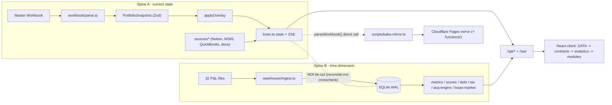

# System Overview — Oxford Command Center

**Status:** Architecture lock file — no implementation agent may silently diverge from this document. If implementation conflicts with this file, update this file first (Lead Architect approval required), then implement.

**Last verified:** 2026-10-28 against `origin/main` (f642175) — migration counts and the module map (section 5) re-checked against the code; remaining sections last refreshed 2026-10-03 (6a6b186); section 7 (build state) and section 8 (roadmap) are historical snapshots, see their notes.

---

## 1. Purpose

The Oxford Command Center is a **local-first investment intelligence platform** for Oxford Realty Advisors (OH/MD/IN/WI/MO/KS/TN). It is not a general-purpose dashboard. Every feature must answer the question: *did this help ORA make a better capital allocation decision?*

---

## 2. Two-Spine Architecture

The system has two parallel data spines. This is the central architectural fact. Agents must understand which spine they are working on.

```
SPINE A — "Current State" (live, workbook-driven)
─────────────────────────────────────────────────
Master Workbook .xlsx (OneDrive/SharePoint)
  → server/workbook/parse.ts          ExcelJS reader
  → Zod PortfolioSnapshot.parse()     Typed boundary (validation gate)
  → applyOverlay(data/overlay.json)   User mutations (gitignored, write surface)
  → loadQuickbooks(QUICKBOOKS_CSV)    QB sidecar (SharePoint CSV export)
  → reconcile (scripts/reconcile.ts)  $0-tolerance self-totals check
  → /api/snapshot + /sse              Push to client
  → src/analytics/engine.ts           buildAnalytics() → AnalyticsBundle
  → 14 rail destinations        UI rendering (src/shell/modules.tsx)

Supplemental live sources (appended to Spine A):
  Notion deals/tenants → server/sources/notion-*.ts
  M365 tasks   → server/sources/m365-tasks.ts (Graph)
  AI agent     → /api/ai (12 tools, server/ai/tools.ts)
  FRED macro   → server/macro/getMacro.ts (FRED_API_KEY required; seeded fallback)
  Doc RAG      → server/sources/documents.ts (sqlite-vec index, local embeddings)

SPINE B — "Time Dimension" (historical, warehouse-driven)
─────────────────────────────────────────────────────────
Property Financials folder (32 P&L .xlsx/.xlsm files, OneDrive)
  → server/warehouse/detect.ts        Filename grammar + alias matching
  → server/warehouse/parse/qb-excel.ts Multi-format P&L parser (QB/Yardi/AppFolio)
  → RawStatementSchema.parse()        Validated boundary
  → server/warehouse/raw-store.ts     SHA-256 immutable raw copy
  → server/warehouse/mapping.ts       Account → classification (manual>seed>learned)
  → server/warehouse/ingest.ts        Transactional commit pipeline
  → better-sqlite3 (WAL)             SQLite warehouse, 38 numbered migrations (001–037; two share 017) (see database-schema.md)
  → server/warehouse/metrics.ts       Pure in-memory computation layer
  → server/warehouse/growth.ts        NOI trend / CAGR / since-acquisition
  → server/warehouse/drivers.ts       ΔNOI decomposition
  → server/warehouse/anomalies.ts     Statistical anomaly detection
  → server/warehouse/benchmarks.ts    Cross-property percentile ranking
  → server/warehouse/scores.ts        Health (0-100) / attention / capital scores
  → /api/warehouse/*                  Served to the warehouse-backed modules
  → src/modules/intel/ (Financials) + others   Intelligence UI
```

**Critical defect (structural — must not regress):** `Property.noi` (Spine A, workbook formula cell) and `warehouse ledger NOI` (Spine B, `Σ revenue+recovery−opex`) are independent computations with no reconciliation check. Two numbers both called "NOI" can silently disagree. No new scoring or capital-allocation engine may consume both without explicit tie-out. See Phase 1a (basis discipline, commit 631963e).

---

## 3. Server Architecture

```
server/index.ts         Hono 4 app, 127.0.0.1:8911 (BRAIN_SERVER_PORT), request boundary first:
                        host-guard -> localhost CORS -> access-authz (ACCESS_REQUIRE=1 only) -> rate limits
  server/brain.ts       ExcelJS + chokidar file watcher -> in-memory snapshot + EventEmitter -> /sse
  server/workbook/      Workbook parser + counterparty graph
  server/overlay.ts     data/overlay.json -- the one user write surface
  server/macro/         FRED API + seeded fallback macro data
  server/ai/            Streaming Claude agent (12 tools) + deterministic responder
  server/alerts/        Alert inbox state
  server/brief/         Daily brief + critical-alert email (run from the mirror bake)
  server/briefing/      Per-property / per-manager PDF briefings, confidentiality scan
  server/sources/       Notion deals/tenants, M365 tasks, QuickBooks CSV, document RAG (doc-index worker)
  server/ar/            Receivables / delinquency import
  server/insights/      Insight ranking + generators
  server/notion/        Capital-action write-back
  server/warehouse/     SQLite financial warehouse (Spine B)
    db.ts               open + migrate (WAREHOUSE_DB env var)
    migrate.ts          Migration runner -- numbered SQL files applied in order
    migrations/         001_initial.sql ... 037_acq_current_scored_at.sql
    ingest.ts           Full pipeline: detect->parse->map->foot->commit
    api.ts              /api/warehouse Hono router (injected db getter)
    sub-routers.ts      Sub-router mount list (debt, insurance, tax, capital, lease-market, brain, ...)
    queries.ts          Read queries (no side effects)
    actions.ts          Mutations (approve/reject import, add mapping, resolve issue)
    acq-*.ts            Acquisition engine + Notion/HubSpot sync
```



**Server invariants:**
- Warehouse is opened lazily on first `/api/warehouse/*` request (not at boot — cold/mirror envs lack the SQLite file).
- Warehouse path: `process.env.WAREHOUSE_DB ?? 'data/warehouse/finance.sqlite'`.
- All `/api/*` routes enforce localhost-only CORS — never expose to external origin.
- `npm run dev` holds a read-write warehouse connection and writes occupancy on each refresh. `openWarehouse` sets a 15s `busy_timeout` (tunable via `WAREHOUSE_BUSY_TIMEOUT_MS`), so a concurrent `warehouse:backfill` now WAITS out an overlapping write instead of dying on `SQLITE_BUSY` — a live dev server and a backfill coexist. (`gate` was never blocked regardless: `reconcile` reads only the workbook, `warehouse:verify` builds in a temp dir, and `warehouse:drift` opens the live DB read-only.)

---

## 4. Client Architecture

```
src/
  contracts/          Zod domain schemas — the ONLY typed boundary between server + client
  analytics/          buildAnalytics() — single metric source of truth
  data/               TanStack Query hooks + SSE listener + brain context
  brain/              App-wide UI state (drawer, AI panel, command palette)
  shell/              AppShell, Sidebar, TopBar, ScenarioSwitch, module registry (modules.tsx)
  modules/            30 folders: 14 rail destinations + their per-tab panels (see section 5)
  primitives/         StatusPill + other presentation atoms
  charts/             visx chart components (Waterfall, etc.)
  tokens/ lib/        Theme tokens; shared client helpers
```

**Client invariants:**
- Routing is `react-router-dom` (`/:moduleId/*` in `src/App.tsx`); each destination's tabs are addressed with `?tab=<id>`. The module registry in `src/shell/modules.tsx` is the single list of destinations.
- All data flows through `buildAnalytics()` → typed `AnalyticsBundle` — never reach into raw snapshot.
- `data/overlay.json` is the ONLY write surface — gitignored, user mutations only.

---

## 5. Module Map (14 rail destinations + off-rail System Health)

Destinations are entries in the `MODULES` array in `src/shell/modules.tsx` (`ModuleDef.id` drives the URL segment). Each lazily loads one code-split chunk and declares up to five tabs (`?tab=<id>`). The `ID` column differs from the display label in a few cases (**Acquisitions** is `pipeline`, **Brain** is `command-brain`, **Financials** is `intel`). Earlier standalone modules (Principal Home, Tasks, Alerts, Calendar, Renewals, Calibration, Debt, Cash, Monthly Close, Insurance, Taxes, Documents) now live as tab panels inside these destinations. Overlay components (AI Panel, Command Palette, Entity/Deal Drawers) live in `src/brain/` and are not destinations.

| Group | Destination | ID | Path | Tabs |
|-------|-------------|----|------|------|
| Command | Overview | `overview` | `src/modules/overview/` | none |
| Command | Acquisitions | `pipeline` | `src/modules/acquisitions/` | pipeline, workbench, sourcing, grader |
| Command | Worklist | `worklist` | `src/modules/worklist/` | today, alerts, calendar, renewals |
| Command | Brain | `command-brain` | `src/modules/command-brain/` | digest, insights, track-record, feedback, memory |
| Assets | Portfolio | `portfolio` | `src/modules/portfolio/` | properties, trends, expenses |
| Assets | Property Financials | `property-financials` | `src/modules/property-financials/` | none in registry; six in-module views via `?view=` |
| Assets | Financials | `intel` | `src/modules/intel/` | ownership, property, lease-run, benchmarks, managers |
| Assets | Leasing | `leasing` | `src/modules/leasing/` | rollover, rent-roll, forecast, market-rents, tenants |
| Capital | Capital | `capital` | `src/modules/capital/` | allocation, pipeline, debt, cash, close |
| Capital | Property Condition | `property-condition` | `src/modules/property-condition/` | none in registry; five in-module views via `?view=` |
| Capital | Obligations | `obligations` | `src/modules/obligations/` | insurance, taxes |
| Market | Market | `market` | `src/modules/market/` | macro, scorecards, comps, demand |
| Market | Lease Market | `lease-market` | `src/modules/lease-market/` | portfolio, market-rents, radar, changes, data-quality |
| System | Data | `data` | `src/modules/data/` | imports, quality, mappings, calibration, documents |
| (off rail) | System Health | `health` | `src/modules/health/` | none; routable, shown as a TopBar status dot |

Destinations are no longer one-to-one with a spine: warehouse-backed (Spine B) data reaches Financials, Capital, Obligations, Leasing, Lease Market, Brain and Data through `/api/warehouse/*`.

---

## 6. Static Mirror

The Cloudflare Pages static mirror (`ora-command-center.pages.dev`, behind Cloudflare Access) is a read-only copy. It has no Brain Server and no live warehouse. The bake (`scripts/bake-mirror.ts`) writes `public/snapshot.json` + `public/macro.json`; an optional heavier bake (`scripts/bake-warehouse.ts`, via `--warehouse` / `BAKE_WAREHOUSE=1`) writes `public/warehouse.json` holding computed warehouse route payloads. Pages Functions in `functions/api/` provide the Ask panel (`ai.ts`, the same agent code as the Brain Server, reading the baked snapshot), Access identity (`whoami.ts`) and edge acquisition scoring (`warehouse/acquisition/score.ts`). Confidential deals are redacted by default; `MIRROR_INCLUDE_CONFIDENTIAL=1` is an explicit opt-in only for an Access-verified target, and `data/overlay.json` stays local. Deployment is `scripts/deploy-mirror.ps1`, run by an off-fleet Windows scheduled task (hourly plus 06:45 ET) from an isolated build root reset to `origin/main`, followed by an Access-gate re-verification.

---

## 7. Current Build State

Not tracked in this file (it went stale within days of being written). Current sources of truth:

| Item | Source |
|------|--------|
| Gate steps | `package.json` scripts `gate` (11 steps, local) and `gate:ci` (CI subset); description in `CLAUDE.md` section 6 |
| CI | `.github/workflows/ci.yml`, `order-fragility.yml`, `full-gate-selfhosted.yml` |
| Warehouse schema | `server/warehouse/migrations/` (001 through 037) and `architecture/database-schema.md` |
| Phase status | `CLAUDE.md` section 3 |
| Merge history | `git log` |

---

## 8. Roadmap Phases

Maintained in `CLAUDE.md` section 3 (phases 1a through 5 and the design-parity waves are recorded there as merged). Master plan: `docs/superpowers/specs/2026-06-13-ora-intelligence-platform-master-plan.md`.
