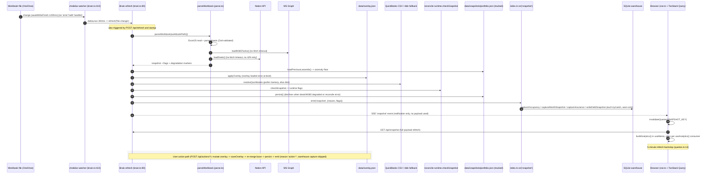
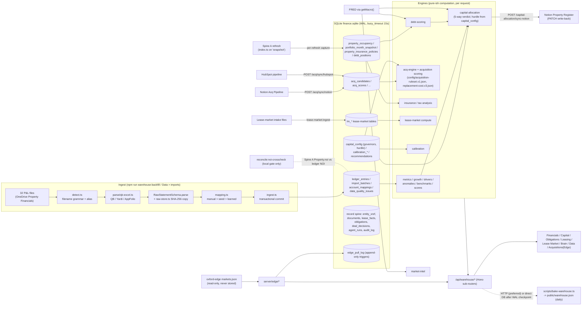
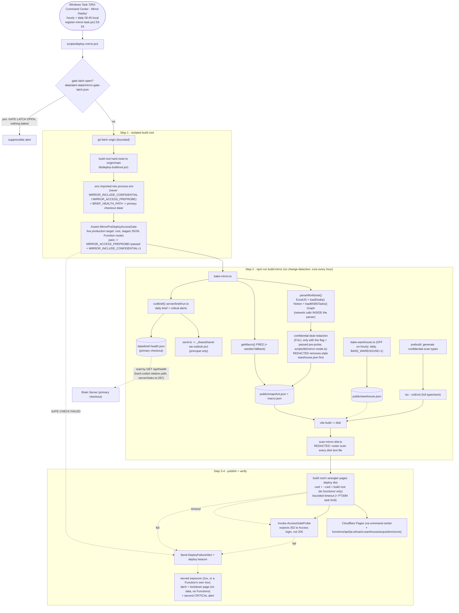

# System diagrams

Sequence- and subsystem-level companions to the architecture diagram in the root `README.md`.
Each was verified on 2026-10-06 against `034fdf1` (the CI diagram was re-checked and corrected on 2026-10-28 against `f642175`); `origin/main` at `0d98bfc` differs only in
`tests/` (PR #440). The `file:line` evidence comments are a snapshot; re-verify before relying on a
specific line. Annotations in square brackets (for example "no fetch timeout") mark known gaps
tracked in the 2026-10-06 improvement plan, not intended behavior.

`architecture/system-overview.md` still carries the older ASCII chains; replacing them there is an
architect-owned edit (CLAUDE.md section 4) and is pending.

## Spine A refresh (sequence)

Workbook save -> parse (with Notion/Graph calls inside the parser) -> overlay/QuickBooks merge -> runtime reconcile -> persist gate -> warehouse capture -> SSE notify -> client refetch. Supersedes the ASCII Spine A chain in `architecture/system-overview.md`.

<details><summary>Evidence</summary>

- server/brain.ts:80-187,276-320,403-417; server/workbook/parse.ts:23-24,1662,1671;
- server/index.ts:148-280,360-367,630-655; src/data/sse.ts:13-35; src/data/provider.tsx:19-21; src/data/queries.ts:13,42

</details>



## Spine B warehouse

Ingest pipeline, table groups, Spine A captures, Notion/HubSpot acquisition syncs, Oxford Edge, FRED into engines, Notion write-back, warehouse bake, and the local-only NOI cross-check.

<details><summary>Evidence</summary>

- system-overview.md:41-56 (pipeline order, verified file presence); server/warehouse/sub-routers.ts:24,65;
- acq-hubspot-sync.ts:141,180,255,275; acq-notion-sync.ts:133,151; notion/capital-writeback.ts:40,125,217;
- api.ts:~904,~923,973-982; server/edge/loader.ts:15,34-35; edge/config.ts:12-17; edge/pull-queue.ts:4,253;
- capital-allocation.ts:50-53; market-intel.ts:2,66; debt-api.ts:26; scripts/bake-warehouse.ts:12-14,89,332,369;
- server/index.ts:148-280; scripts/reconcile-noi-crosscheck.ts; server/warehouse/reconcile-noi.ts

</details>



## Mirror deploy and daily brief

The off-fleet Windows task: gate-latch check, isolated build root, PRE-deploy Access probe of the live target, `build:mirror` (bake, brief + Outlook COM send, typecheck, vite build, dist roster scan in REDACTED mode), bounded wrangler deploy from the build root, post-deploy Access 302 probe, failure alert, and lockdown containment on a served exposure (audit wf_9bf74429-aaf findings 1/4/30/31, 2026-11-12).

<details><summary>Evidence</summary>

- scripts/register-mirror-task.ps1:53-57; scripts/deploy-mirror.ps1:22,45-63,169,246,280-303,358;
- package.json build:mirror/build/prebuild; scripts/bake-mirror.ts:3,6,196,267-279;
- server/workbook/parse.ts:23-24,1662,1671; server/brief/run.ts:26; server/brief/send.ts:8; server/index.ts:287-298

</details>



## CI and gates

Hooks vs permissions.deny, local `gate` (11 steps) vs `gate:ci` (9 steps), PR-only refute attestation, required checks (`gate`, `refute-required`), and what never runs automatically.

<details><summary>Evidence</summary>

- package.json scripts gate, gate:ci, prepare, hooks:install, check:refute;
- .github/workflows/ci.yml:13-16,49-59,73,80,95; order-fragility.yml:44; full-gate-selfhosted.yml:11-12,24;
- scripts/check-refute-required.ts:4-6,9-12,57-62,220,238,307-345; .claude/settings.json:63-68; .claude/hooks/*;
- vitest.config.ts:76-90 (no thresholds); scripts/*.smoke-test.ps1 (not invoked by any workflow or npm script)

</details>

```mermaid
flowchart TB
    DEV["Agent / Gabriel session"] --> HOOKS["Claude PreToolUse hooks<br/>bash-guard.mjs, file-guard.mjs (fail-open)<br/>+ permissions.deny confidential-terms.json (fail-closed)"]
    DEV --> COMMIT["git commit"]
    COMMIT --> CMSG["commit-msg hook<br/>(trailer guard; installed by npm prepare)"]
    COMMIT --> LGATE["npm run gate (LOCAL, 11 steps, manual)<br/>governance, typecheck, lint, check:dev-css,<br/>check:schema-drift, test, reconcile:snapshot,<br/>reconcile, reconcile:noi-crosscheck,<br/>warehouse:verify, warehouse:drift"]
    LGATE -. needs .-> DATA[("OneDrive workbook + 32 P&L files<br/>+ live finance.sqlite")]
    COMMIT --> PUSH["git push"]
    PUSH --> PREPUSH["pre-push hook<br/>1) confidential scan (blocking) 2) refute-trailer gate (blocking) 3) NOI cross-check (advisory)"]

    PUSH --> TRIG{"event"}
    TRIG -- "PR (any branch)" --> CI
    TRIG -- "push to main" --> CI
    TRIG -- "push to other branch, no PR" --> NONE["no CI"]

    subgraph CI["ci.yml (runner: ubuntu-latest or laptop when CI_RUNNER=self)"]
        G["job gate: npm ci --include=dev -> npm run gate:ci (9 steps)<br/>governance, typecheck, lint, check:dev-css, check:schema-drift,<br/>test, reconcile:snapshot, build, check:bundle"]
        R["job refute-required (PR only):<br/>check:refute --strict base..head<br/>per-commit Refute-Reviewed / Refute-Skip trailer"]
    end
    R -. "attests" .-> WF["refute-financial-change workflow<br/>.claude/workflows/refute-financial-change.js<br/>(run id in trailer; not path-referenced by the check)"]

    CI --> BP["branch protection: required checks 'gate', 'refute-required'"]
    BP --> SQUASH["squash-merge to main<br/>(squash msg must carry UNION of trailers; nothing re-checks on main)"]
    SQUASH --> MIRRORTASK["hourly mirror task builds origin/main<br/>(see "Mirror deploy and daily brief" above)"]

    subgraph notrun["NOT run automatically"]
        E2E["test:e2e (Playwright smoke + a11y)"]
        COV["test:coverage (no thresholds)"]
        FMT["prettier check (no script)"]
        PS["9 scripts/*.smoke-test.ps1 (deploy path)"]
        FULL["full-gate-selfhosted.yml (workflow_dispatch only)"]
    end
    CRON["order-fragility.yml weekly Mon 09:00 UTC<br/>test:shuffle, pinned ubuntu-latest (ignores CI_RUNNER)"]
```
