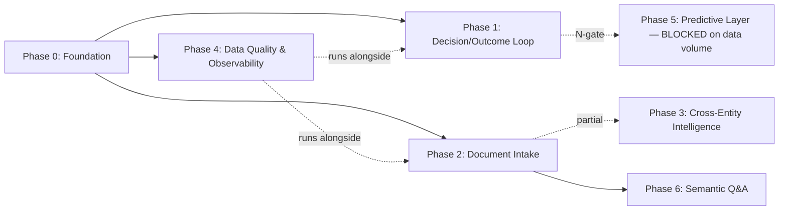

# Master Roadmap — Oxford Intelligence Platform

Scope: implement the architecture approved in the 2026-07-28 review (fact/document/edge schema extending the existing SQLite warehouse; Claude-native extraction, no bespoke OCR/graph-DB/vector-DB infra; deterministic-compute/LLM-narrate boundary preserved). This roadmap governs *only* the new institutional-memory layer — it does not re-plan the Financial Intelligence warehouse, which is built and merged (see README).

## How to read the phase table

Only **Phase 0** and **Phase 1** are broken into epics and tasks below. Phases 2–6 have purpose/value/dependencies/risk/completion-criteria only. This is deliberate, not an oversight — see "Why phases 2+ aren't ticketed yet."

| Phase | Purpose | Depends on | Est. duration* | Status |
|---|---|---|---|---|
| 0 — Foundation | Fact/document/edge schema, backup, confidentiality tiering, ADR bootstrap | none | 2–3 weeks | Not started |
| 1 — Decision/Outcome Loop | Capture underwriting thesis as data; track actual-vs-expected on a cadence | Phase 0 | 3–4 weeks | Not started |
| 2 — Universal Document Intake | Extend lease-abstraction extraction pattern to insurance/loan/PCA/invoice/tax docs | Phase 0 | 4–6 weeks, one doc type at a time | Not started |
| 3 — Cross-Entity Intelligence | Vendor/PM/tenant pattern queries across the edge graph | Phase 0 + partial Phase 2 | 2–3 weeks | Not started |
| 4 — Data Quality & Observability | Automated fact/graph integrity checks + a Platform Health surface | Phase 0 | 2 weeks, then ongoing | Not started |
| 5 — Predictive/Pattern Layer | "What predicts success," "what mistakes recur" | Phase 1 outcome data at sufficient N (see gate below) | **Not scheduled** | Blocked on data volume |
| 6 — Semantic Q&A Surface | Ask-a-question interface over the whole corpus | Phase 2 (meaningful corpus) | 2–3 weeks | Deliberately last |

*Duration estimates assume one person (Gabriel) directing Claude Code sessions part-time alongside normal deal flow — not a dedicated engineering team's velocity. Treat these as order-of-magnitude, not commitments.

---

## Phase 0 — Foundation

**Business value:** every later phase depends on facts being source-cited, versioned, and confidentiality-tagged from birth. Retrofitting this after Phase 2 starts writing thousands of facts is the single most expensive mistake this roadmap can make (see ADR-0002, ADR-0004).
**Dependencies:** none — but must not touch the existing `server/warehouse/` engine tables, only add alongside them.
**Technical risks:** touching a live, 2,700+-test, reconcile-to-$0-gated warehouse. Mitigate by strictly additive migrations (new tables only, no ALTER on existing ones) and running the full gate before and after every task.
**Completion criteria:** `facts`, `documents`, `edges` tables exist, migrated, tested, documented in `architecture/database-schema.md`; nightly off-machine backup of `finance.sqlite` + the document store is running and has been manually verified restorable once; confidentiality tier is a required column, enforced at write time; the ADR folder exists with the first five decisions recorded; `architecture/status.json` has a live entry for this initiative.

### Epics

**E0.1 — Fact/Document/Edge schema**
- Objective: add the three generalized tables from the approved architecture (§2 item 2–3) to the warehouse without touching existing engine tables.
- Inputs: approved architecture doc (this session's prior turn), existing `server/warehouse/schema.ts` (or equivalent — verify exact filename at kickoff).
- Outputs: migration file(s), Zod contracts, `warehouse:verify` extended to check the new tables' referential integrity.
- Dependencies: none.
- Complexity: medium (schema design is settled; the work is careful integration with existing migration tooling).
- Acceptance criteria: migration runs idempotently on a copy of the live DB; new tables enforce `confidence`, `source_doc_id`, `valid_from`/`valid_to`, `confidentiality_tier` as non-null; a round-trip test writes a fact, supersedes it, and confirms the original is queryable by `valid_time`.
- Future improvements: `sqlite-vec` extension for the `documents` table once Phase 6 needs semantic recall — not now.

**E0.2 — Confidentiality tiering enforcement**
- Objective: every fact/document/edge row carries a `confidentiality_tier` (`public | internal | deal-confidential`) and the existing `confidentiality-guard.py` egress pattern is extended to check it on any query path an agent or narrative can reach, not just external publish/send actions.
- Inputs: `~/.claude/hooks/confidentiality-guard.py`, `confidential-terms.json`.
- Outputs: a query-layer guard (new) that rejects or redacts `deal-confidential` rows unless the caller is explicitly scoped to that deal.
- Dependencies: E0.1.
- Complexity: medium-high — this is genuinely new territory (the existing guard gates writes/sends, not reads inside an agent's reasoning).
- Acceptance criteria: a test that seeds a confidential fact and confirms it cannot appear in a narrative brief, semantic search result, or cross-entity query unless explicitly authorized; false-negative rate on this test is the one number in this whole roadmap that must be zero, not "low."
- Future improvements: per-property/per-deal scoped API keys if the platform ever gets a second human user.

**E0.3 — Backup & restore**
- Objective: close the gap flagged in the architecture review — the warehouse and document store currently live on one unmirrored volume.
- Inputs: existing backup pattern (`~/.claude/backups/` for config) as a style reference; does not need to reuse that mechanism.
- Outputs: a nightly scheduled task (via `register-scheduled-task`, following the existing dual-fleet doctrine) that snapshots `finance.sqlite` + a manifest checksum of the document store to a location off the C: volume.
- Dependencies: none (can run in parallel with E0.1/E0.2).
- Complexity: low-medium.
- Acceptance criteria: one full restore has been performed onto a scratch path and diffed against the source — not just "the backup file exists."
- Future improvements: point-in-time restore granularity if the fact table's supersede-not-overwrite pattern ever needs rollback beyond what git-tracked migrations give you.

**E0.4 — ADR bootstrap**
- Objective: create `docs/adr/` and record the five hardest-to-reverse decisions from the architecture review as the first ADRs, so "why did we decide X" survives past this conversation.
- Outputs: `docs/adr/README.md` + 5 ADR files (delivered with this roadmap — see `docs/adr/`).
- Dependencies: none.
- Complexity: low.
- Acceptance criteria: each ADR has Context/Decision/Consequences and is referenced from the relevant epic above.

### Phase 0 task graph

Tasks are sized 1–4 hours. IDs are stable identifiers for status.json / commit messages (`IP-0.x`).

| ID | Title | Effort | Prereqs | Files likely affected | Tests required | DoD |
|---|---|---|---|---|---|---|
| IP-0.1 | Draft `facts`/`documents`/`edges` Zod contracts + migration | 3h | none | `server/warehouse/contracts.ts` (or equiv), new migration file | Contract unit tests | Migration applies cleanly on a DB copy; `npm run gate` green |
| IP-0.2 | Extend `warehouse:verify` to check new tables' referential integrity (no orphaned edges, no fact without a source doc) | 2h | IP-0.1 | `scripts/warehouse-verify.ts` (or equiv) | New verify-script unit tests | Verify script fails loudly on a seeded bad row |
| IP-0.3 | Round-trip test: write fact → supersede → query by valid_time | 2h | IP-0.1 | `tests/warehouse/facts.test.ts` | This is the test | Green in CI, not just locally |
| IP-0.4 | Add `confidentiality_tier` enum + non-null constraint to all three tables | 1h | IP-0.1 | same migration/contract files | Constraint-violation test | Insert without tier fails |
| IP-0.5 | Build the query-layer confidentiality guard | 4h | IP-0.4 | new `server/security/query-guard.ts` (or equiv) | Zero-false-negative test suite (see E0.2 acceptance) | Guard wraps every read path an agent can reach |
| IP-0.6 | Wire query-layer guard into the AI panel / narrative / search read paths | 3h | IP-0.5 | `server/ai/`, `src/brain/` | Integration test per read path | A seeded confidential fact provably cannot leak through any of them |
| IP-0.7 | Design + register nightly backup scheduled task | 2h | none | new scheduled-task SKILL.md, backup script | Manual restore verification (not automatable in CI) | One real restore performed and diffed |
| IP-0.8 | Write ADR-0001..0005 | 3h | none | `docs/adr/*` | n/a (docs) | Reviewed against the actual approved architecture, not paraphrased from memory |
| IP-0.9 | Create `architecture/status.json` entry for this initiative + update `architecture/database-schema.md` | 1h | IP-0.1 | `architecture/status.json`, `architecture/database-schema.md` | n/a | Entry present, schema doc matches migration |
| IP-0.10 | Full-gate run + phase closeout: update this roadmap's status column, archive plan doc | 1h | all above | this file | `npm run gate` | Phase 0 marked complete only after a clean gate run is pasted into the PR |

**Rollback:** every task in this phase is additive (new tables, new files, new scheduled task). Rollback = drop the new tables / disable the scheduled task / revert the PR. None of it touches existing engine tables, so rollback never risks the reconciled financial warehouse.

---

## Phase 1 — Decision/Outcome Loop

**Business value:** the highest-value capability in the entire vision — "how accurate has our underwriting been" — and currently only half-built (theses live in IC memos as prose, not as structured, diffable data).
**Dependencies:** Phase 0 (needs `facts`/`edges` to store the Decision and Outcome entities).
**Technical risks:** low technical risk, moderate process risk — this requires Gabriel to actually structure underwriting assumptions at IC-memo time going forward, which is a workflow change, not just a schema change.
**Completion criteria:** every acquisition decision since `deal-decision-ledger.md`'s start has a structured `Decision` record; a scheduled `Outcome Tracker` agent (see agent roadmap) runs on a fixed cadence and produces a variance report without fabricating a comparison when data is genuinely missing.

### Epics (objective-level only — task graph generated via `writing-plans` at kickoff, per the JIT policy below)

- **E1.1 — `Decision` schema + backfill.** Structure the existing `deal-decision-ledger.md` entries into the `edges`/`facts` model. Backfill is bounded (finite, already-decided deals) — do this once, by hand-assisted extraction, not a general-purpose pipeline.
- **E1.2 — Outcome capture cadence.** Define trigger points (annual per property, or event-triggered at refi/renewal/disposition) and what "actual" data feeds the comparison (warehouse NOI/growth engines — already built, just needs to be joined to the Decision's original assumptions).
- **E1.3 — Outcome Tracker agent.** Build per the agent roadmap spec. This is new code, not a data-only task.
- **E1.4 — Variance reporting into deal-decision-ledger.md.** Close the loop back into the existing memory artifact rather than creating a new, competing report format.

---

## Phase 2 — Universal Document Intake

**Purpose:** extend the lease-abstraction-pipeline extraction pattern (already built, already production-tested) to insurance policies, loan documents, PCAs, vendor invoices, tax bills.
**Business value:** this is what actually populates the fact/document store with real institutional memory — without it, Phase 0's schema is an empty warehouse.
**Dependencies:** Phase 0.
**Technical risks:** extraction accuracy on messy scanned PCAs and handwritten invoices will be the real bottleneck, not engineering. Budget a human-review step per document type at rollout; do not assume zero-touch extraction on day one for any type.
**Duration:** one document type at a time, each roughly a 1–2 week slice; do not attempt all five types in parallel.
**Completion criteria (per document type):** a golden-document regression set exists; extraction accuracy on that set is measured and reported, not assumed; the Reconciler agent (agent roadmap) is wired to flag contradictions with existing facts before write.

## Phase 3 — Cross-Entity Intelligence

**Purpose:** answer "which vendors consistently outperform," "which PMs create the most value," "which markets exceeded expectations" via joins/recursive queries over the `edges` table.
**Dependencies:** Phase 0 fully, Phase 2 partially (needs enough ingested documents that the answer isn't statistically noise on 3 data points).
**Risk:** premature launch — answering these questions credibly needs a minimum sample size per entity type. Gate each specific query on a documented minimum-N before it ships as a claim, not just before it ships as code.

## Phase 4 — Data Quality & Observability

**Purpose:** formalize the checks in §9/§10 of the roadmap brief (duplicates, missing metadata, conflicting facts, broken relationships, stale info, incomplete extraction, invalid schema, orphaned documents, version conflicts) as automated, scheduled checks, and surface system health (extraction accuracy, queue depth, processing speed, DB growth, search quality, graph size, AI accuracy, automation success rate, failures) on a dashboard.
**Dependencies:** Phase 0 (needs the schema to have something to check).
**Note:** this can and should start as soon as Phase 0 ships its first tables — it does not need to wait for Phase 2/3. Treat it as a parallel workstream, not a sequential phase (see dependency graph).

## Phase 5 — Predictive/Pattern Layer

**Purpose:** "what characteristics predict success," "what mistakes do we repeatedly make."
**Status: intentionally not scheduled.** This phase is gated by data volume, not engineering effort. At 27 properties and a young Decision/Outcome dataset (Phase 1 just started), you do not have enough labeled outcomes for pattern-detection to say anything statistically meaningful — building this now would produce confident-sounding nonsense, which is worse than not having it. **Gate:** revisit only once Phase 1 has produced outcome records for at least ~15–20 completed hold-or-decision cycles, or ORA crosses into a portfolio size where cross-sectional comparison (not just longitudinal) becomes viable. Track the count, don't guess at the date.

## Phase 6 — Semantic Q&A Surface

**Purpose:** the "ask questions instead of searching" interface over the full document corpus.
**Dependencies:** Phase 2 (needs an actual corpus worth querying).
**Why last:** this is the least differentiated, most demo-friendly part of the whole vision — Claude already does adequate ad hoc Q&A over data you hand it today. Building it first (as the original vision's phase ordering implicitly invited, by listing "Search" as Phase 5 of 12) would optimize for an impressive demo over actual decision-quality improvement. Deliberately sequenced last.

---

## Why phases 2+ aren't ticketed yet

The repo has direct, dated evidence that pre-baked, long-range task lists rot fast: `docs/superpowers/specs/2026-06-13-ora-intelligence-platform-master-plan.md` had its entire "real gaps" list superseded within five weeks — every item it called 0%/absent/roster-only had shipped by 2026-07-17, and the file had to carry a correction notice rather than being trustworthy as written. A 2-year, 12-phase roadmap with hundreds of hand-ticketed 1–4-hour tasks for work that won't start for 6+ months would go stale the same way, except worse — nobody would even notice until a session tried to execute a task graph built against requirements that already changed underneath it.

The fix: **task-graph detail is generated just-in-time**, via `superpowers:writing-plans`, at the start of each phase, using the phase's Epics (above) as the brief. Completed task graphs get committed to `docs/superpowers/plans/` (existing convention) and this file's phase table gets its status column updated. This is what makes the roadmap "living" rather than a document that's accurate on the day it's written and wrong every day after.

---

## Dependency graph

- **Critical path:** Phase 0 → Phase 1 (the highest-value capability gates on the foundation; nothing else matters if this doesn't ship).
- **Parallel workstreams:** Phase 4 (Data Quality & Observability) can and should run alongside Phases 1–2 rather than after them — it's cheap to build incrementally and expensive to retrofit once bad data has accumulated.
- **Independent modules:** the Outcome Tracker agent (Phase 1) and the Extractor/Reconciler agents (Phase 2) share no code and can be built by separate sessions without coordination once Phase 0's schema is settled.
- **Bottleneck:** E0.2 (query-layer confidentiality guard) is the one Phase 0 task with a zero-tolerance correctness bar — do not let schedule pressure compress its test suite.
- **Safely postponable:** Phase 3 and Phase 6 both have soft dependencies on "enough data" as much as "enough code" — if Phase 2 is slower than estimated, postpone these without any other phase being blocked.
- **Architectural choke points (see ADRs):** the entity ID scheme (ADR-0003) and the facts-table shape (ADR-0002) are both referenced by every later phase's queries — get them right in Phase 0 or every subsequent phase inherits the cost of a migration.

---

## Risk register

| Risk | Category | Likelihood | Impact | Mitigation |
|---|---|---|---|---|
| LLM narrates a wrong number with unearned confidence in an unsupervised brief | AI / data | Medium | High (bad $ decision) | Deterministic-compute/LLM-narrate boundary (ADR-0005) enforced by test, not convention; Adversarial Verifier agent on anything financial |
| Confidentiality leak through a cross-referencing query path | Security | Low-medium | Severe (Hard Invariant 3 breach) | Query-layer guard (E0.2) with a zero-false-negative test bar |
| Roadmap itself goes stale like the 2026-06-13 plan did | Process | High if not designed against | Medium | JIT task-graph generation (above), phase-table status kept current every session |
| Scope creep — 2-person team, unbounded vision | Operational | High | High (nothing ships) | Phase 5/6 explicitly deferred with hard gates; no phase past 1 is ticketed until its predecessor ships |
| Single-volume data loss (warehouse + document store) | Operational | Low but catastrophic | Severe | E0.3 backup, verified by actual restore, not just "job ran" |
| Extraction accuracy on messy scans overestimated | AI / data | Medium-high | Medium | Golden-document regression set per doc type before rollout; human-review step assumed, not treated as a stretch goal |
| Entity ID / schema choices made in Phase 0 turn out wrong | Technical debt | Low if reviewed carefully | High (system-wide migration) | ADR-0002/0003 written and reviewed *before* Phase 0 code, not after |
| Vendor/platform lock-in (Claude-specific prompts, formats) | Vendor | Low | Medium | Facts/docs/edges stored as plain SQL + files; prompts versioned separately (see standards doc) so the reasoning layer is swappable even if the data layer isn't |

---

## Living roadmap mechanism

- **This file** holds phase purpose/value/dependencies/risk and epic/task detail for the *current and next* phase only.
- **`architecture/status.json`** holds live claim/ownership/blocker state — read before starting any task, updated when a task starts/completes.
- **`docs/superpowers/plans/`** holds the dated, JIT-generated task graph for whichever phase is actively being built; archived (not deleted) once the phase ships.
- **`docs/adr/`** holds decisions that are expensive to reverse — added to, never rewritten; a superseded ADR gets a new ADR that references it, per standard ADR practice.
- **`architecture/system-overview.md` / `database-schema.md` / `api-contracts.md`** absorb anything durable once a phase ships — this roadmap should not duplicate content that belongs there permanently.
- **Reprioritization:** if a phase's dependency changes (e.g., Phase 5's data-volume gate is hit, or Phase 2 reveals a document type isn't tractable), update the phase table and dependency graph in this file in the same PR that discovers the change — never let the written roadmap and the real state diverge silently.

---

## Mandatory self-critique (per Gabriel's brief — revise, don't defend)

**Weakest part:** the Phase 1 Outcome Tracker depends on Gabriel changing a real workflow habit (structuring IC-memo assumptions as data, not prose) — that's a people/process risk no amount of engineering rigor fixes. If that habit doesn't stick, Phase 1 ships code that never gets fed real Decision records, and Phase 5 never becomes viable no matter how long you wait.

**Highest-risk assumption:** that Claude-native document understanding is "good enough" to skip a dedicated OCR pipeline (Phase 2). This was the right call against the procurement stance and against operating a second system solo, but it is unverified for ORA's actual worst-case documents (handwritten PCA notes, degraded fax-quality older leases). Phase 2's first epic for *any* document type should include a small adversarial sample of the ugliest real documents in the portfolio before committing to the no-OCR decision at scale — if accuracy is unacceptable on that sample, revisit before building five document-type pipelines on a shaky assumption.

**Missing capability, still:** point-in-time restore granularity. E0.3 gives you "we can restore last night's snapshot," not "we can recover a fact that was wrongly superseded three weeks ago without also losing everything after it." Given the bitemporal design already avoids overwriting, this is lower-urgency than it would otherwise be (the old value is still in the table, just not what a naive snapshot restore returns) — noted as a Phase 4 candidate, not Phase 0, and flagged here so it doesn't get silently forgotten.

**Over-engineering caught and removed:** the original brief's Phase 8–12 structure (Dashboards / Automation / AI Agents / Prediction / Continuous Learning as five separate phases) implied five more rounds of epics and task graphs before anything in the vision's actual highest-value idea (outcome tracking) shipped. Collapsed into the 7-phase table above, with Prediction explicitly unscheduled and Continuous Learning folded into "what Phase 5 becomes once it has data" rather than a standalone phase — a phase with no engineering content of its own doesn't deserve a phase number.

**Under-engineering flagged, not fixed:** the confidentiality query-guard (E0.2) is specified as a single new component with a "zero false negatives" bar, but this roadmap does not yet design *how* it's tested to that bar beyond "a test suite." Before E0.5 is implemented, that test suite itself needs a design pass — this is real work being deferred to Phase 0 kickoff, not solved here, and should not be treated as done just because it's on the task graph.

**Technical debt likely to emerge:** the `edges` table will accumulate relation types ad hoc as each phase needs a new one (`OWNED_BY`, `SECURED_BY`, `PERFORMED_BY`, ...). Without a registry of valid relation types enforced at the schema or application level, this becomes an untyped string field with no contract by Phase 3. Recommend an enum/lookup table for relation types be part of E0.1, not added later once five phases are already writing untyped strings into it.
