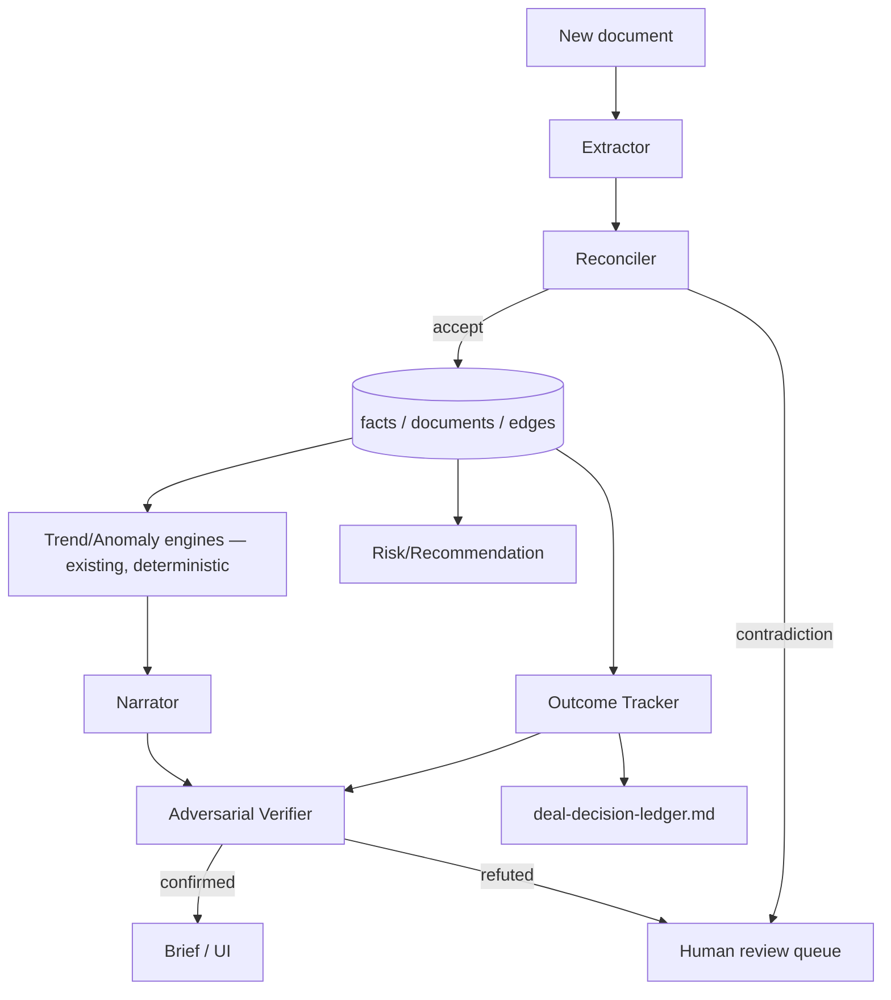

# AI Agent Roadmap — Oxford Intelligence Platform

Design rule carried over from the architecture review: specialized agents, not one giant system. Every agent here is a Claude Code skill or subagent — this repo does not need a bespoke multi-agent framework; `~/.claude/agents/*.md` and the skills system already are that framework.

Three of the seven agents below already exist and are listed for completeness/interaction-mapping only — do not rebuild them.

---

## Extractor (new — Phase 2)

- **Mission:** turn one arriving document into structured, source-cited facts.
- **Responsibilities:** classify document type from content (never filename); extract fields per the type's schema (extends the lease-abstraction-pipeline's 32-field pattern to other doc types).
- **Inputs:** raw document (PDF/image/scan) + its `documents` row.
- **Outputs:** candidate `facts` rows (unwritten — pending Reconciler approval), each with `confidence` and `source_doc_id`.
- **Tools:** Claude native document understanding (no separate OCR service, per ADR — ties to the self-critique's flagged risk: verify against worst-case scans before trusting this at scale).
- **Validation:** golden-document regression set per doc type; a known document must always re-extract to the same structured output.
- **Memory:** none of its own — writes only to the shared facts/documents store; stateless between runs by design.
- **Failure recovery:** low-confidence or schema-invalid extractions are quarantined (not silently dropped, not silently written) and surfaced to a review queue.
- **Monitoring:** extraction accuracy against the golden set, tracked per doc type over time (Phase 4 observability).
- **Upgrade path:** new document types are additive — new schema + new golden set, no change to the agent's core loop.
- **Interaction:** hands every candidate fact to the Reconciler before anything is written.

## Reconciler (new — Phase 2, pattern already proven)

- **Mission:** never let a new fact silently overwrite or contradict the system of record.
- **Responsibilities:** cross-check a candidate fact against existing facts/edges for the same entity; on contradiction, flag rather than auto-resolve, unless the new fact is explicitly a superseding amendment.
- **Inputs:** candidate facts from the Extractor, existing facts table.
- **Outputs:** accept (write) / flag-contradiction (human review) / supersede (explicit amendment case).
- **Tools:** the warehouse's existing reconcile pattern (`npm run gate`'s `reconcile`/`reconcile:noi-crosscheck` steps are the proof this pattern already works here) — extend, don't reinvent.
- **Validation:** seeded-contradiction test suite; a wrong-but-plausible fact must never pass silently.
- **Memory:** none of its own; reads the shared store.
- **Failure recovery:** anything it can't confidently resolve goes to the review queue, same as the Extractor's low-confidence path — one shared queue, not two.
- **Monitoring:** flag rate over time; a rate that's too low is as suspicious as one that's too high (it may mean the Reconciler stopped checking, not that data quality improved).
- **Upgrade path:** contradiction rules grow per entity type as Phase 2 covers more document types.
- **Interaction:** gate between Extractor and storage; also invoked ad hoc by any agent about to write a fact.

## Outcome Tracker (new — Phase 1, the core gap)

- **Mission:** answer "how accurate has our underwriting been" as a standing capability, not a one-off analysis.
- **Responsibilities:** on a fixed cadence (annual per property) or trigger (refi/renewal/disposition), pull the property's original `Decision` record's assumptions and diff against current `Outcome` facts (sourced from the existing warehouse growth/NOI engines — deterministic compute already built).
- **Inputs:** `Decision` entity, current warehouse metrics.
- **Outputs:** a variance report (assumption vs. actual, per line item) written back into `deal-decision-ledger.md` — extending the existing artifact, not creating a competing one.
- **Tools:** warehouse analytics engines (read-only), facts/edges store.
- **Validation:** if a Decision record has genuinely incomplete data (e.g., no original rent-growth assumption was captured), the agent must say so explicitly — a "verified null," never a fabricated comparison (existing doctrine, extended here).
- **Memory:** the variance reports themselves are the memory; no separate state.
- **Failure recovery:** if the trigger fires but the warehouse hasn't ingested that period's data yet, defer and log — never compare against stale or partial data silently.
- **Monitoring:** how many properties have a complete Decision→Outcome pair vs. how many are missing one (this count is also the gate for Phase 5).
- **Upgrade path:** once enough variance reports exist, this agent's output becomes the primary input to Phase 5 (once unblocked).
- **Interaction:** reads from the warehouse (existing), writes to deal-decision-ledger.md (existing), is the direct data source for Phase 5.

## Risk/Recommendation (partially exists: tenant-intelligence, exception-detection, portfolio-anomaly-scout — extend, don't replace)

- **Mission:** surface renewal risk, vendor underperformance, and cross-source exceptions before they become problems.
- **Responsibilities:** run the existing risk-scoring/exception-detection skills against the expanded fact/edge graph as it grows through Phase 2–3, not just their current narrower data sources.
- **Inputs:** facts/edges store, existing tenant/vendor scoring logic.
- **Outputs:** prioritized flags, consistent with the existing exception-detection output shape.
- **Tools:** existing skills, extended.
- **Validation:** precision tracked against manually confirmed true/false positives — an alert-fatigue metric, not just a coverage metric.
- **Memory:** flag history, to detect recurring vs. novel exceptions.
- **Failure recovery:** over-flagging degrades to "log only" for a pattern until a human confirms it's worth alerting on again.
- **Monitoring:** precision/recall against confirmed flags (Phase 4).
- **Upgrade path:** grows in coverage as Phase 2/3 add entity types and relationships.
- **Interaction:** consumes the same facts/edges store everything else writes to; does not gate any write path (it's read-only/advisory).

## Adversarial Verifier (exists as a pattern: `refute-financial-change` workflow, `verified-deal-recon`'s 3-verifier design — apply here, don't rebuild)

- **Mission:** kill unsupported claims before anything financial is trusted, especially anything the Narrator is about to say out loud.
- **Responsibilities:** independent-lens review (correctness / security / repro, or domain-appropriate equivalents) on any fact or narrative claim that will influence a financial decision.
- **Inputs:** a draft claim + its cited facts.
- **Outputs:** confirmed / refuted, majority-vote across independent lenses.
- **Tools:** the existing workflow pattern.
- **Validation:** this agent *is* the validation step for others — its own correctness is checked by periodic seeded-bad-claim tests (a known-wrong claim must get refuted).
- **Memory:** none; stateless per review.
- **Failure recovery:** defaults to refuted (not confirmed) on ambiguity — asymmetric by design.
- **Monitoring:** refute rate over time; a rate near zero suggests it's rubber-stamping.
- **Upgrade path:** none needed — this is a pattern, not a growing system.
- **Interaction:** invoked by the Narrator before any number-bearing sentence ships, and by the Outcome Tracker before a variance claim is written.

## Narrator (exists: JARVIS daily brief, Intel module — no rebuild, extend coverage as facts grow)

- **Mission:** narrate deterministic output in prose; never compute or invent a number.
- **Interaction:** consumes warehouse engine output + facts store; every number-bearing claim routes through the Adversarial Verifier first (this is the concrete mechanism enforcing ADR-0005, not just a stated principle).

## Trend/Anomaly (exists: `server/warehouse/{growth,drivers,anomalies,scores,benchmarks}.ts` — no rebuild)

- **Mission:** deterministic compute only. Listed here purely to show where the agent graph closes the loop: Extractor → Reconciler → facts store → Trend/Anomaly engines (existing) → Narrator (existing, verified by Adversarial Verifier) → Risk/Recommendation flags → Outcome Tracker variance reports back into deal-decision-ledger.md.

---

## Interaction diagram

